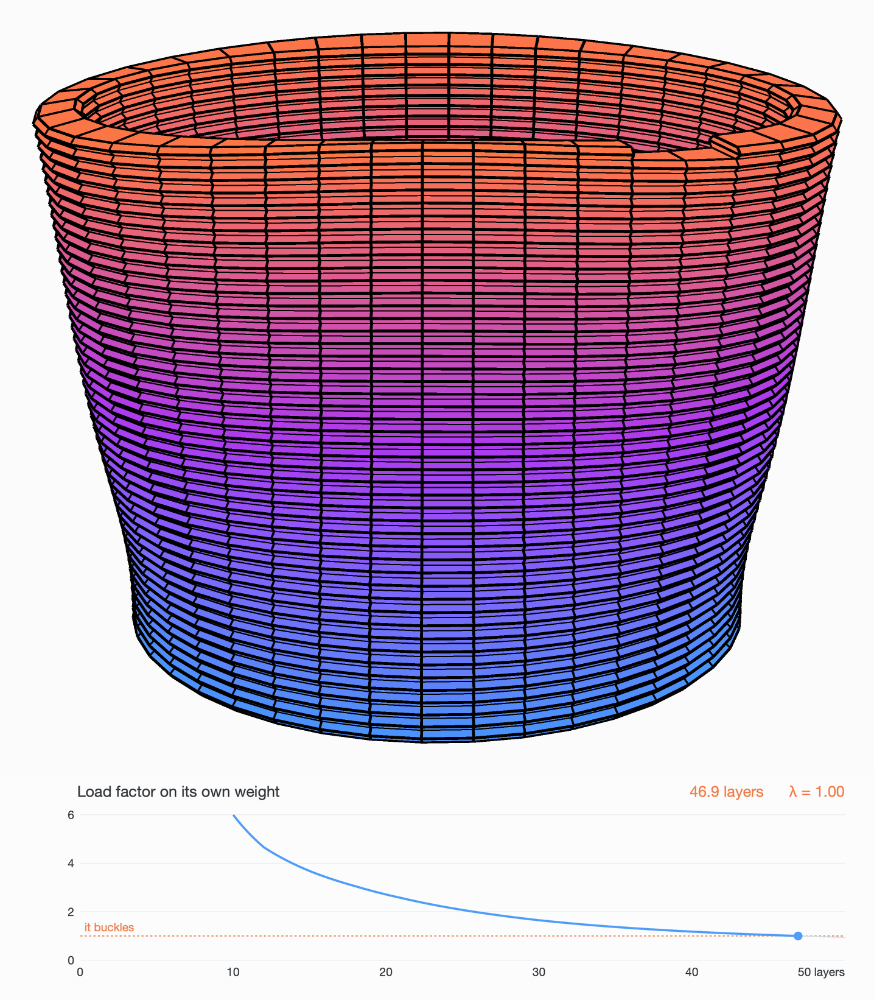
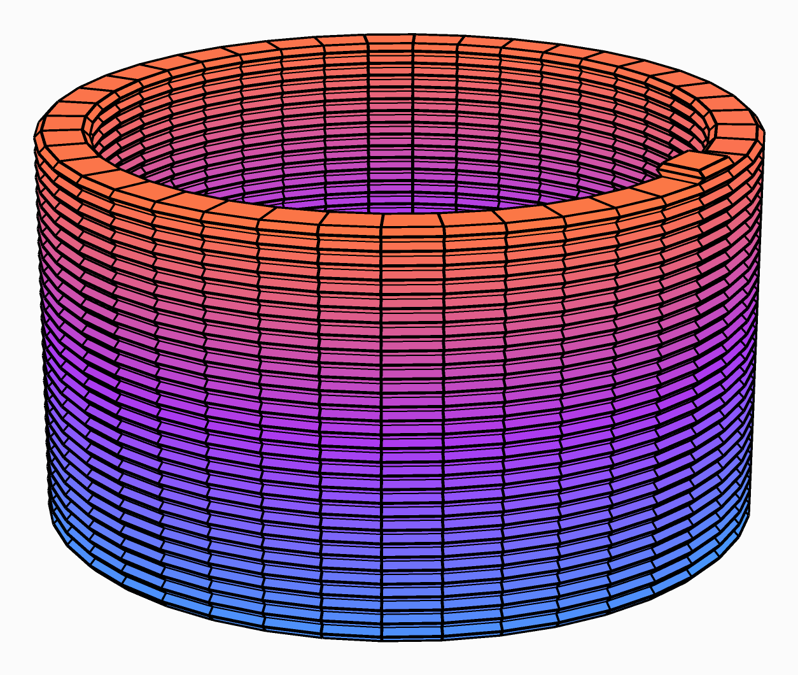
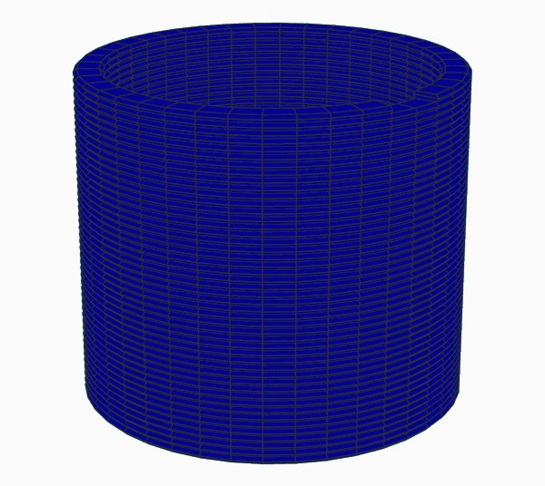

# 🖨️ Printed Cylinder

<figure><figcaption></figcaption></figure>

[printed-cylinder](printed-cylinder.gh)

A 3D printed wall carries its own weight from the first layer, while its concrete is still
setting. The bottom layers are the oldest and the stiffest, the top ones the youngest, and with every
layer the load grows. This example checks a cylinder for buckling while it is printed: move
**Time** on and more of it is printed, and Linear Buckling gives the factor on its own weight at
which it buckles at that moment.

The cylinder is the one TU/e printed and modelled (Wolfs, Bos and Salet, "Early age mechanical
behaviour of 3D printed concrete", *Cement and Concrete Research* 106, 2018): a print path of radius
250 mm, layers 40 mm wide and 10 mm high, printed at 5 m/min, a lap every 0.31 minutes. Their mortar
stiffens with age, $$E = 0.078 + 0.0012\,t$$ MPa with $$t$$ in minutes, and weighs 2070 kg/m³.

<figure><video src="printed-cylinder-printing.mp4" autoplay loop muted playsinline></video><figcaption>
The cylinder as it is printed, eight steps a lap, its concrete coloured by age - orange just printed, blue the oldest. Under it, the load factor on its own weight, falling to 1 at 47 layers.
</figcaption></figure>

<figure><figcaption>
At 30 layers: the concrete just printed in orange, the oldest in blue.
</figcaption></figure>

## The model

| Group | What it does |
| --- | --- |
| 1 - The print path | A circle of radius 250 mm on the print bed: the heart line of the wall. |
| 2 - Printing | **Printed Layers**, a GhPython component: 60 layers of 40 × 10 mm on that path, their sides round, cut 1 brick across, 2 up and 4 cm along, printed at 5 m/min. **Time** says how far the print has got; each brick comes with its age and a colour by age. |
| 3 - Fresh concrete | **Fresh Concrete**, a GhPython component: each brick's age into its stiffness, Wolfs' mortar. |
| 4 - The joint and the bricks | With **Joint** above 0, a band that thick at the bottom of each layer, which **Surface Connection**, a GhPython component, gives a stiffness per area **Ks**; at 0 the layers are bonded, as wet on wet. Then the [SSP Bricks](../../docs/basics/elements/brick.md), coloured by age. |
| 5 - The print bed | A [Support](../../docs/basics/elements/support.md) holding the first layer where it rests. |
| 6 - Self-weight | [Gravity Load](../../docs/basics/loads/gravity.md): the only load while printing. |
| 7 - Assemble | [Assemble](../../docs/basics/assemble.md), with a tolerance of 0.5 mm, below the distance between two rows of nodes. |
| 8 - Buckle | [Linear Buckling](../../docs/basics/analysis/linear-buckling.md): the factor on the concrete's weight at which the wall buckles, and the wall in that shape. A second [Model View](../../docs/basics/visualisation/model-view.md) draws the wall as printed. |

## The three Python components

The printing is done by three GhPython components, which you can open and change: they are part of
this example, not of the plugin.

- **Printed Layers** sweeps a filament along each layer's path. Its section is an oval: a rectangle
  **Width** × **Height** whose sides are rounded in by **Round** × **Height** / 2, as a half
  ellipse; the layers touch over the flat between. The section is cut into **Across** × **Up**
  bricks and swept from one division point of the path to the next. The nozzle runs the paths one
  after the other at **Speed**: a brick is printed once the nozzle has passed it, and its age is the
  time since it passed its middle. The top of one layer and the bottom of the next are the same
  points, so Assemble welds them: its **Tolerance** has to be below the distance between two rows
  of nodes.
- **Fresh Concrete** turns each age $$t$$ into an elastic material:
  $$E(t) = E_0 + r\,t = 0.078 + 0.0012\,t$$ MPa, with $$\nu = 0.3$$ and 2070 kg/m³ - Wolfs, Bos and
  Salet's mortar over its first 90 minutes. Give it a **Final** stiffness and it levels off towards
  it instead, starting at the same rate, as an accelerated concrete does (Suiker 2018).
- **Surface Connection** gives the bricks of a joint band the material of springs spread over the
  joint: a band $$t$$ thick with $$E_z = k_n t$$ and $$G_{xz} = G_{yz} = k_s t$$ closes by
  $$\sigma / k_n$$ and slips by $$\tau / k_s$$. Its material is marked as a surface connection, so
  that [Linear Buckling](../../docs/basics/analysis/linear-buckling.md) gives the band the
  geometric stiffness of a joint, not of a band: a stack of layers on slipping joints then buckles
  at Haringx's load, as a laminated rubber bearing does.

## What it shows

At 10 layers the wall could carry five times its weight before buckling; at 30, 1.65 times; at
40, 1.18. The factor reaches 1 at about 47 layers, 47 cm: there the wall buckles under its own
weight. It buckles as a ring: the wall necks in just above the base, where it is held on the print
bed and carries the most, and flares out above - the "cylindrical buckling" TU/e saw in their prints.

The lab cylinders fell earlier, at 25 to 31 layers, 29 on average, and TU/e's Abaqus model at 40 to
53 layers. They fell by buckling and by the concrete yielding at the base together: this example is
the elastic buckling alone, which is where the factor says it is. The concrete's strength grows
with age too, and a wall can yield before it buckles.

Each move of **Time** is a new analysis: about 10 seconds at 30 layers, 15 at 45.

**Try:**

- **Speed** lower: each layer has longer to stiffen before the next is on it.
- **Round** 0: square sides, as wide as the filament; the wall is stiffer than with round ones.
- **Joint** 1 mm and **Ks** lower: the layers slip on their joints, and the wall buckles sooner.
- **Across** and **Up** higher: a finer cut, and a slower one.

<figure><figcaption>
The buckling mode at 47 layers, red where it moves most: the wall necks in above its base and flares out above.
</figcaption></figure>
