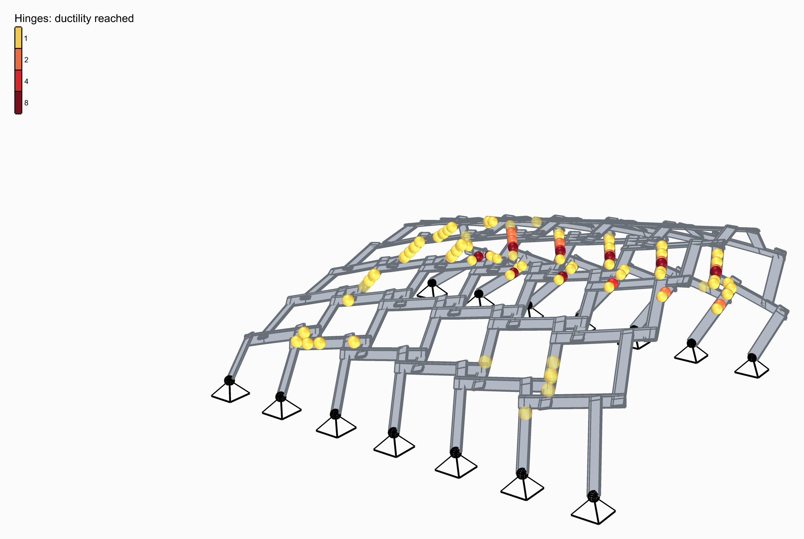
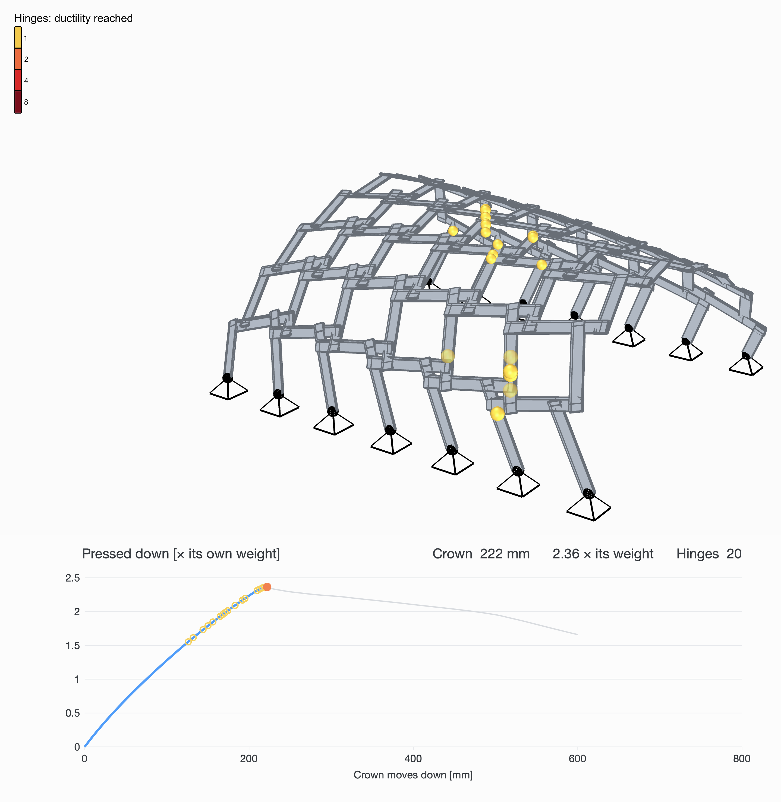
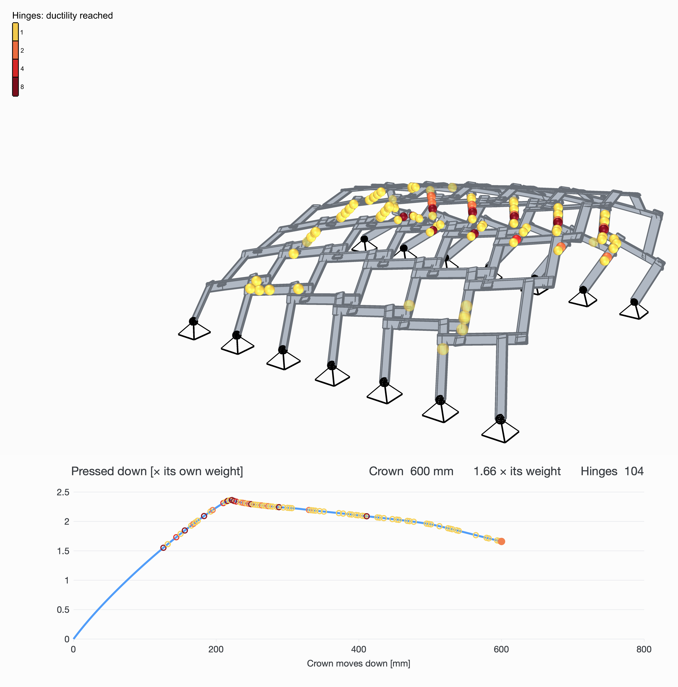
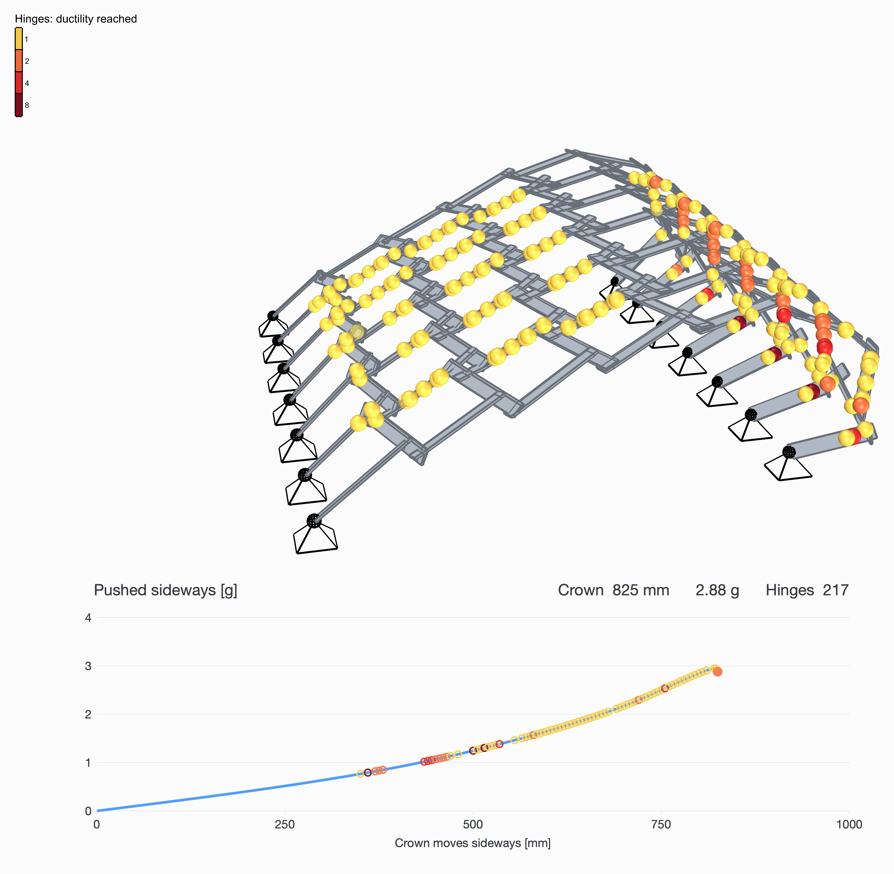
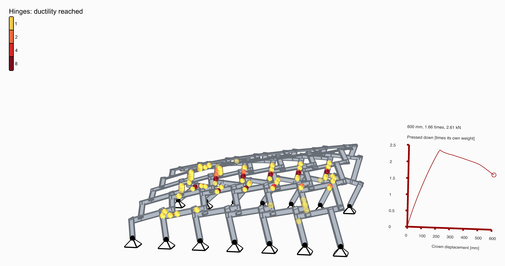

# 🪵 Reciprocal Vault Pushover

<figure><figcaption></figcaption></figure>

[reciprocal-vault-pushover](reciprocal-vault-pushover.gh)

A reciprocal frame holds itself up: every member rests on the next, and the last rests on the
first. This one is a barrel vault 4 m across, 2 m high and 4.8 m long, of 98 planks of birch
plywood 127 x 18 mm - about 47 inches by 5 by 3/4, the size of a cut from a standard sheet - laid
in a pinwheel pattern, one bolt at each crossing. Each plank is a chain of
[ForceBeamColumns](../../docs/basics/elements/force-beam-column.md) on a
[Fiber Section](../../docs/basics/moment-curvature/fiber-section.md), so it can yield, and each bolt
a [Spring Link](../../docs/basics/elements/spring-link.md).
[Pushover Analysis](../../docs/basics/analysis/pushover.md) holds its own weight, then adds more of
it, pressing the vault down until it gives way.

<figure><video src="reciprocal-vault-pushover-pushing.mp4" autoplay loop muted playsinline></video><figcaption>
The push, a frame every second point of the curve, drawn as it is: the displacements are as large as they look. A ball marks each point where the plywood has yielded, and stays: yellow at first, then orange, red and dark red as the plywood there is strained to 2, 4 and 8 times its yield strain; faded once it has unloaded. Under it, the curve so far, a ring where each plastic hinge formed, in the colour it has reached.
</figcaption></figure>

## The model

| Group | What it does |
| --- | --- |
| 1 - Geometry | The sliders, and a Python component that draws the vault from them: a pinwheel pattern drawn flat on a grid of **Cell** - round every node four planks turn about an opening **Fan** wide, each resting on the next - wrapped round an arch of **Span** and **Rise**. It then moves the planks, crossing by crossing, until every crossing is one **Plank thickness** deep, as they sit once built, and cuts each plank where it crosses the others. **Direction** says which way to push: Z presses it down, Y or X push it sideways. |
| 2 - Planks | [Steel01](../../docs/basics/moment-curvature/steel01.md) standing in for birch plywood: 9 000 MPa, yielding at 25 MPa, b 0.01. A rectangle of **Plank width** by **Plank thickness** meshed into 6 x 8 fibres, a [Patch](../../docs/basics/moment-curvature/patch.md), in a [Fiber Section](../../docs/basics/moment-curvature/fiber-section.md) with the GJ of a flat plank. A [ForceBeamColumn](../../docs/basics/elements/force-beam-column.md) on it for every piece of plank between two bolts, 434 of them, its local z out of the plank's face; a second Python component gives each a Corotational transformation. |
| 3 - Bolts and feet | A [Spring Link](../../docs/basics/elements/spring-link.md) at each of the 168 crossings, 18 mm long, from the plank under to the plank on top, of five [Uniaxial Elastic](../../docs/basics/materials/Uniaxial.md) springs: 100 000 kN/m along the bolt, 4 000 kN/m across it, 20 kN m/rad for the two planks turning against each other; about the bolt itself, nothing. The feet are [Supports](../../docs/basics/elements/support.md) that hold them where they stand and let them turn. |
| 4 - Loads | Its own weight, a [Gravity Load](../../docs/basics/loads/gravity.md) of **Density** / 7 850 - Steel01 weighs as much as steel - in a [Load Pattern](../../docs/basics/loads/load-pattern.md) on a [Linear time series](../../docs/basics/time-history/linear.md). The push: its weight again, a [Point Load](../../docs/basics/loads/point-load.md) at every node, each its share of the planks round it. |
| 5 - Pushover | [Assemble](../../docs/basics/assemble.md), with a Tolerance of 2 mm, well under the bolts' 18 mm, and [Pushover Analysis](../../docs/basics/analysis/pushover.md): the bolt nearest the crown pushed **Push to** mm along Direction, in **Steps** steps. |
| 6 - Results | **Point on the curve**, and a Python component that draws the curve beside the vault and hands Model View that point's step. A [Model View](../../docs/basics/visualisation/model-view.md) of the vault at that step, drawn as it is, its planks grey, with **Plastic hinges** ticked; a [Legend](../../docs/basics/visualisation/legend.md) of the hinges' colours; one of the vault at rest; and panels of the **Hinges**, in the order they formed, and of what OpenSees said. |

## The planks and the bolts

Where two planks cross, one rests on the other, so their axes are a plank's thickness apart, along
the line square to both. The geometry moves the planks until every crossing is exactly that deep -
18 mm, to within a thousandth of a millimetre - and a Spring Link of that length joins the two
axes. That offset is what makes a reciprocal frame work, and also what makes it soft. Around the
arch, bending passes from plank to plank only through the planks along the vault, as a twist, and
a plank 18 mm thick twists easily.

A single bolt lets two planks turn about it, so the links leave that direction out. Across the bolt
they take 4 000 kN/m, EN 1995's slip modulus at the ultimate limit state for an 8 mm bolt in
plywood of 680 kg/m³. Give a Uniaxial Elastic its **Eneg** as well as its **E**: left alone,
**Eneg** is 210 000 000, and a spring stiff one way and soft the other is not a bolt.

Steel01 is a stand-in. Plywood is about 9 000 MPa along its face grain and crushes at some 25 to
30 MPa. Check a maker's sheet before trusting any number here.

## How it is pushed

The vault weighs 1.57 kN. Pushover Analysis applies that weight over ten steps and holds it. It then
puts the same weight again on the nodes, as Point Loads, and scales them together, so the load
factor reads in times the vault's own weight. It controls the bolt nearest the crown: 200 steps of
3 mm take it 600 mm down, whatever the load does on the way.

The vault moves a long way before it gives way, so its beams are Corotational. With P-Delta, the
default in Pushover Analysis, the vault gives way at half the load: P-Delta follows a frame that
leans, but not planks that turn this far. No Grasshopper component makes a Corotational
transformation, so a small Python component makes one for each piece of plank and hands it to
ForceBeamColumn's GeomTransf input.

## What it shows

Pressed down, the vault carries its own weight and 2.36 times as much again, with its crown 222 mm
down. Then it gives way: the crown keeps dropping as the load falls off, to 1.66 times at 600 mm.

It gives way at its open ends. There, the planks round the arch cross only the planks along the
vault, and nothing stiffens the edge. When the crown has gone down 222 mm, the top of an open end
has moved 700 mm. The first plastic hinges form at 126 mm, at about 1.5 times its weight, a
metre up the arch near each open end: one at one end on one side, one at the other end on the other
side, as the pinwheel turns. By the end of the
push, 104 points of the planks have yielded.

The colours of the hinges show how far each has gone. By 600 mm, 82 are still under twice their yield
strain (yellow), 10 have passed 2 (orange), 3 have passed 4 (red) and 9 have passed 8 (dark red). The
most strained point, at 31 times its yield strain, is in a plank at a foot near an open end. 17 have
faded: they yielded and then unloaded, as the open ends folded and the planks elsewhere unbent.

<figure><figcaption>
The peak.
</figcaption></figure>

<figure><figcaption>
The end of the push, and the whole curve.
</figcaption></figure>

Pushed sideways (Direction Y), it does not give way. It leans further and further, and it stiffens
as its planks are pulled into a net. Its weight pushed sideways, 1 g, takes the crown 425 mm across.
The first plastic hinge forms at 350 mm and 0.74 g. At 825 mm and 2.88 g the push stops, because a
step will not converge. By then 217 points of the planks have yielded.

<figure><figcaption>
Pushed sideways: the curve climbs.
</figcaption></figure>

Drag **Point on the curve** to see the vault at any point of the curve. The **Hinges** panel names
each hinge and the point where it formed.

<figure><figcaption>
The vault and its curve, as the example opens in Rhino.
</figcaption></figure>

## What it leaves out

- **Plywood breaking.** Steel01 yields in tension as it does in compression, where a plank of
  plywood would crack. The first Hinges, at about 1.5 times its weight, are where a real vault would
  start to.
- **The bolts.** They never slip in their holes, never crush the plywood round them and never tear
  out. A vault built with play in its holes moves more under its own weight than this one, and it
  starts to give way sooner.

## Try

- **Direction** Y and **Push to** 1000: the vault leans, and the curve climbs.
- **Plank thickness** 24 mm.
- **Fan** wider: longer planks, a more open pattern.
- **Displacement** on in Model View's Results menu, for how far each part has moved: the hinges are then harder to read on its colours.
