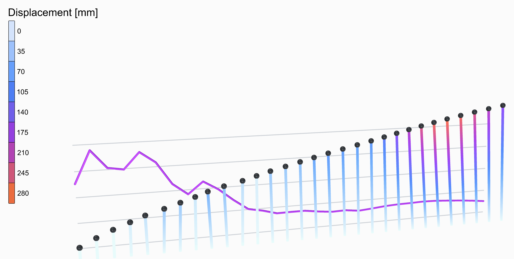
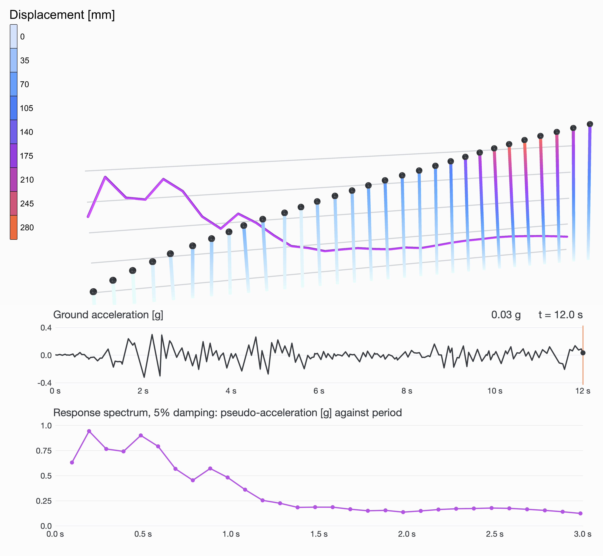

# 📈 Response Spectrum from Sticks

<figure><figcaption></figcaption></figure>

[response-spectrum](response-spectrum.gh)

A response spectrum answers one question for a given earthquake: how far does a structure that swings at a given period move? This example answers it the way the spectrum is defined, by building the structures. A row of thirty steel tubes, built in at the ground with a 4 t mass on top, from 1 m to 10 m tall: each is an oscillator with one way to swing along the shaking, at a period of its own. The short ones swing ten times a second, the tall ones once every three seconds. The El Centro earthquake shakes them all, and the most each one moves, plotted against its period, is the spectrum.

<figure><video src="response-spectrum-shaking.mp4" autoplay loop muted playsinline></video><figcaption>
The first 12 s of El Centro, as they happened, the movement drawn larger than it is. Behind the sticks, and in the chart under them, each stick's pseudo-acceleration so far: the spectrum growing as each one reaches further, over the whole spectrum in grey.
</figcaption></figure>

## The model

| Group | What it does |
| --- | --- |
| 1 - Geometry | The sliders, and a Python component that draws the sticks from them: **Sticks** lines from **Shortest** to **Tallest**, **Spacing** apart along x, their heights spread so that their periods are spread evenly (a cantilever's period goes as its height to the power 1.5), and each stick's foot and top. Each stick is a branch of the trees: a model of its own. |
| 2 - Members | An S355 CHS 219.1x8 from [Steel Section Library](../../docs/basics/sections/library.md), as one [ForceBeamColumn](../../docs/basics/elements/force-beam-column.md) a stick: exact for a cantilever. |
| 3 - Supports | Every stick built in at the ground. |
| 4 - Ground motion | A [Mass Point](../../docs/basics/loads/mass-point.md) of **Mass** on each top. The El Centro record from a Python component, its first **Duration** seconds times **Ground motion scale**; a Path Time Series of it; a Load Pattern of the UniformExcitation type along x; copied once a stick with Duplicate Data and put on the masses' branches with Unflatten Tree, so that each stick's model gets its mass and the ground motion. |
| 5 - Analysis | An [MPCO Recorder](../../docs/basics/mpco-recorder.md) that writes the displacements only; [Assemble](../../docs/basics/assemble.md), a model a branch; a [Natural Vibration Analysis](../../docs/basics/analysis/natural-vibration.md) of each, for its period; [Damping](../../docs/basics/analysis/damping.md) of **Damping** % of critical at each stick's own frequency; the Newmark [Integrator](../../docs/basics/analysis/integrator.md); [Analysis Step](../../docs/basics/analysis/analysis-step.md) of 0.005 s, a quarter of the record's; [Analysis Settings](../../docs/basics/analysis/analysis-settings.md) for a transient analysis, the Linear algorithm and a banded solver; and [Run Analysis](../../docs/basics/analysis/run-analysis.md), once a stick. |
| 6 - Results | [Nodal Displacements](../../docs/basics/results/nodal-displacements.md) of each top at every step, and a Python component, **Response spectrum**, that finds the most each top moved and turns it into the spectrum: **Period**, **Sd** and **PSa** in panels, and the spectrum as a line behind the sticks, 8 m to the g, with a line every 0.25 g. A [Model View](../../docs/basics/visualisation/model-view.md) of the sticks at **Step**, drawn 3 times their movement and coloured over 0 to 280 mm for every step alike, with a [Legend](../../docs/basics/visualisation/legend.md) of the first stick's colours, the same for all. Model View solves every branch but draws only the last, so its preview is off and a Mesh parameter, **Every stick**, draws all thirty from its Geometry output. Drag **Step** through the record, 0.005 s a step. |

## How the spectrum is found

Each stick is a single-degree-of-freedom oscillator: almost all its mass is on top, and along the shaking it can only swing. Its **Natural Vibration Analysis** gives its period T. Its transient analysis gives how far its top moves from the ground, step by step; the most it moves at any step is its **spectral displacement** Sd. Times (2π / T)², that is its **pseudo-acceleration** PSa, the acceleration a static force would need to push it that far: PSa against T is the response spectrum, the curve a response spectrum analysis reads its accelerations from.

Two things make it the spectrum and not just thirty analyses:

- **Damping of exactly 5% for every stick.** A spectrum is drawn for one damping ratio. Rayleigh damping is 5% at two frequencies only, so one model with all the sticks would damp most of them more or less than that. Here each stick is a model of its own, its own branch of the trees, and its damping is set at its own frequency: with both of Rayleigh's frequencies at the stick's ω, alphaM = ζω and betaK = ζ/ω give exactly ζ at ω.
- **A small enough step.** The stiffest stick swings ten times a second; Newmark's average acceleration with the record's own 0.02 s step would read it up to 12% off. A step of 0.005 s, with the record interpolated in between, keeps every stick within a few tenths of a percent.

## What it shows

The spectrum rises from the ground's own 0.32 g at the shortest periods to its peaks: 0.94 g at 0.19 s and 0.90 g at 0.49 s. A stiff building of a few storeys swings at about that period, and feels three times the ground's acceleration. Past 0.6 s it falls away, to 0.15 g at 2 s and 0.12 g at 3 s: a tall, soft building feels a seventh of what a squat one does, but moves far more. The tallest sticks sway up to 300 mm, the shortest 1.4 mm. Every stick reaches its most within the first 12 s, so the record is cut there.

<figure><figcaption>
The sticks when they reach furthest together, and the whole spectrum under them.
</figcaption></figure>

Each stick's peak was checked against a single-degree-of-freedom oscillator solved on its own, by Newmark's method with a step of 0.0005 s: all thirty agree within 0.4%.

## Try

- **Another earthquake.** Swap the El Centro component for your own record: its times and accelerations, in m/s², into the Path Time Series, and its number of steps into Analysis Step's expression. The sticks draw its spectrum.
- **More sticks** for a finer spectrum; more **Damping** to watch the peaks flatten.
- **Heavier masses** or **taller sticks** move the row to longer periods.

Thirty transient analyses of 2 400 steps each, and reading back every top at every step, take a minute or two. Each stick is a model of one element, well inside the free limit.
