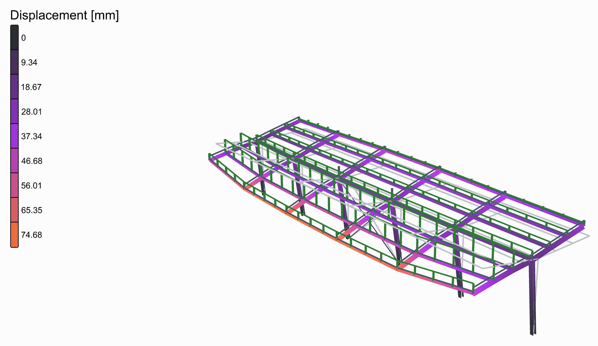
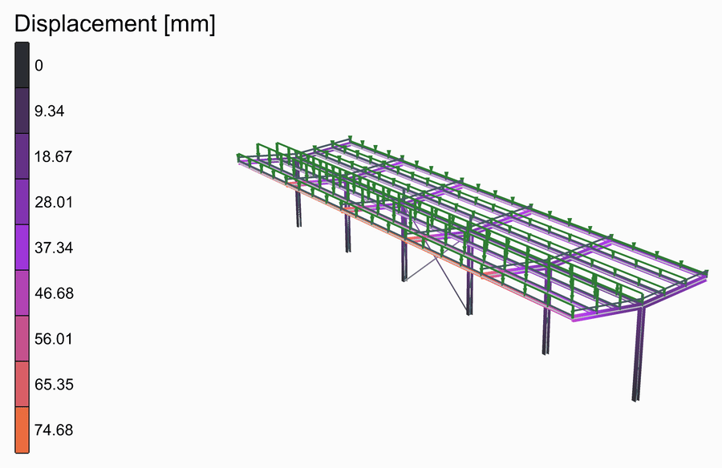
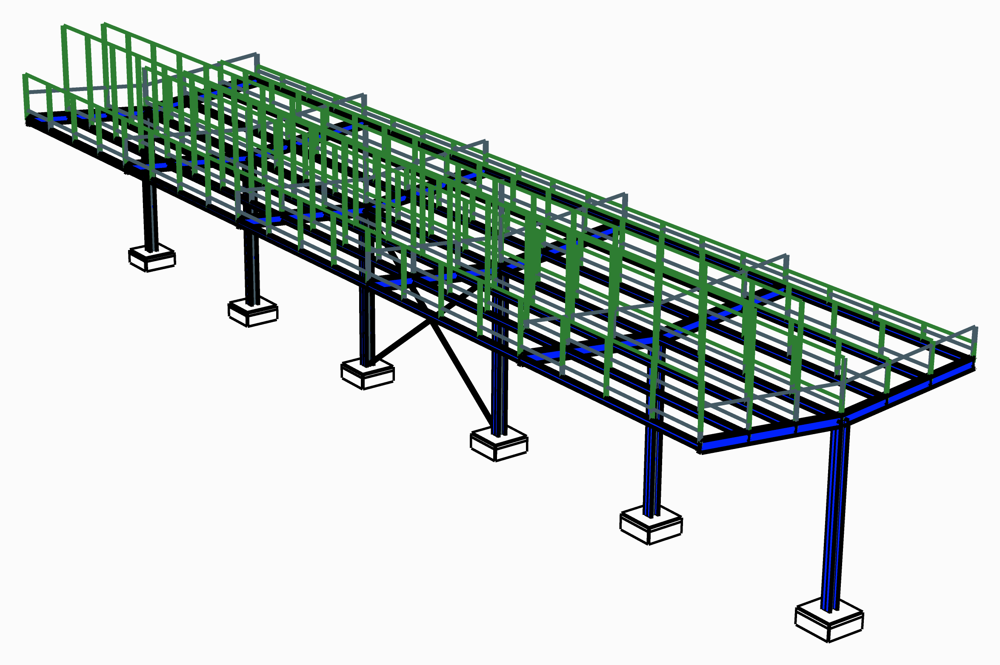

# ⛱️ Roof Canopy

<figure><figcaption></figcaption></figure>

[roof-canopy](roof-canopy.gh)

A row of six frames, 6 m apart, each an HEA240 column built in at its foot with an IPE270 arm cantilevering 4 m each way from its head, rising 0.4 m to its tip. IPE140 purlins join the frames at the heads and at three points along each arm, and a cross between two columns holds the row lengthways. Snow lies deeper on one side than on the other, as wind drifts it, so the frames lean.

<figure><figcaption>
The deformed shape, from rest to its full size and back, its loads riding on it.
</figcaption></figure>

## The model

| Group | What it does |
| --- | --- |
| 1 - Geometry | The sliders, and a Python component that draws the geometry from them: the members as lines, each cut where another meets it, the points the structure is held at, and the widths its loads are worked out from. Open the component to see how. Frames, spacing, height, cantilever, rise and purlins a side. |
| 2 - Members | S355: HEA240 columns, IPE270 arms and IPE140 purlins as [ForceBeamColumn](../../docs/basics/elements/force-beam-column.md); the cross, CHS 60.3x4, as trusses. |
| 3 - Supports | Each column built in at its foot. |
| 4 - Loads | The snow on each side in kN/m², times the width of roof each purlin carries on plan, as two [Linear Load](../../docs/basics/loads/beam-load.md)s; and the own weight. |
| 5 - Analysis | [Assemble](../../docs/basics/assemble.md) and [Run Analysis](../../docs/basics/analysis/run-analysis.md). |
| 6 - Results | A [Model View](../../docs/basics/visualisation/model-view.md) of the analysed model, deformed and coloured by its displacement, with a [Legend](../../docs/basics/visualisation/legend.md); one of the model at rest, as light grey lines behind it; and one of the supports and the loads. The deformed shape is drawn 30 times its size. |

## The loads

The snow is typed in for each side: 1.2 kN/m² on the left, 0.4 kN/m² on the right. Each purlin carries the width of roof between it and its neighbours on plan, half at a tip and at the head, and its share of each side's snow.

<figure><figcaption>
The supports and the loads, as <strong>Model View</strong> draws them: the own weight in its own colour, as OpenSees takes it. Tick <strong>Show Values</strong> in its Loads menu to write what each is worth.
</figcaption></figure>

## What it shows

The left arms' tips drop 75 mm: the arm bends, and the column, built in at its foot, leans under the difference between the two sides. Even the snow out and the frames stand straight; take the cross out and the row is held lengthways only by its columns.
