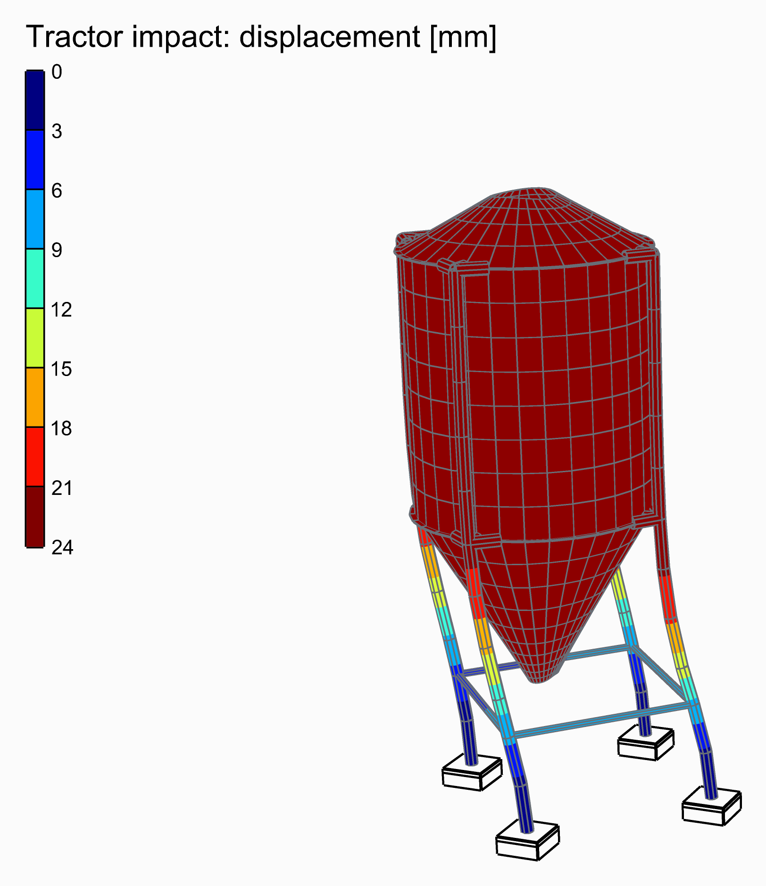
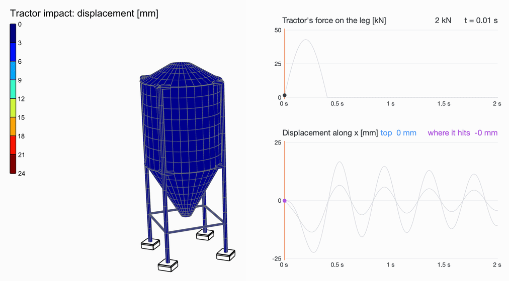
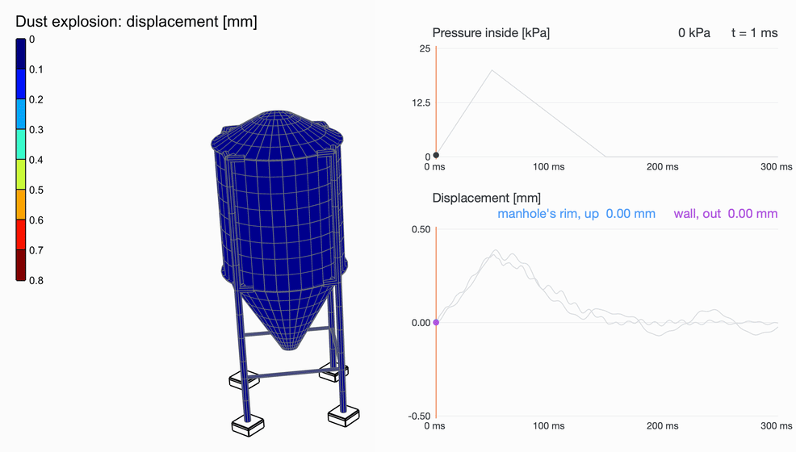
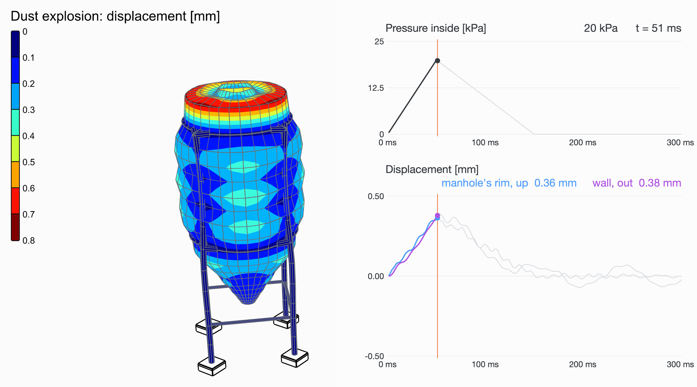
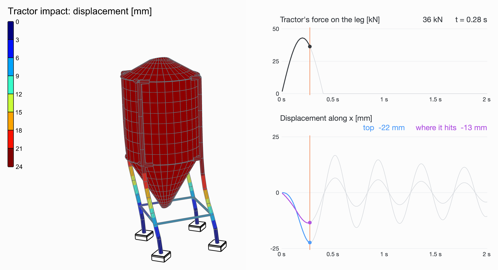

# 💥 Silo: a Dust Explosion and a Tractor's Impact

<figure><figcaption></figcaption></figure>

[silo-explosion-impact](silo-explosion-impact.gh)

A feed silo of glass fibre, as farms have beside their sheds, stands on four steel legs, full of feed. Two things can hit it suddenly. Filling it blows fine feed dust up inside it, and a spark can light the cloud: a dust explosion, the pressure rising in a few tens of milliseconds until the lid of the manhole on the roof blows open and lets it out. Or a tractor reverses into one of its legs. Each is a load that changes in time, a pulse, and a transient analysis follows the silo through it, step by step.

<figure><figcaption>
The tractor's impact, the first 2 s slowed down three times, the movement drawn 20 times larger than it is. Beside it, the tractor's force on the leg, and how far the top of the silo and the point the tractor hits have moved along x.
</figcaption></figure>

<figure><figcaption>
The dust explosion, its first 300 ms slowed down thirteen times, the movement drawn 600 times larger than it is. Beside it, the pressure inside, and how far the edge of the roof's manhole has moved up and the wall between two legs out.
</figcaption></figure>

## The model

| Group | What it does |
| --- | --- |
| 1 - Geometry | The sliders, and a Python component that draws the silo from them: the wall as one mesh of quads - a hopper of **Hopper angle** down to the outlet, **Outlet height** above the ground, the cylinder of **Radius** and **Cylinder height**, and a roof of 30 degrees up to the manhole, left open - with each face's outward normal; the four legs, their brackets, two steel rings round the wall and the ties low down; the legs' feet; the feed as masses at the wall's nodes; and the point the tractor hits. **Wall [mm]** is the wall's thickness. |
| 2 - Members | The wall: glass fibre, an elastic [nD](../../docs/basics/materials/ND.md) material - E 12 GPa, ν 0.3, 1 850 kg/m³ - in a [Plate Fiber Section](../../docs/basics/sections/plate-fiber.md), as [ASD Shell](../../docs/basics/elements/shell.md)s. Legs and brackets of 114.3 x 5 tube and ties of 60.3 x 4 from the [Steel Section Library](../../docs/basics/sections/library.md), and the rings, flat bars 100 x 10, [Rectangular](../../docs/basics/sections/rectangular.md), all S355, on [ForceBeamColumn](../../docs/basics/elements/force-beam-column.md)s. |
| 3 - Supports | The legs' feet bolted down to the slab: built in, [Support](../../docs/basics/elements/support.md). |
| 4 - Event | **Event** picks the dust explosion or the tractor's impact: it turns that event's load pattern on and the other's off, by their factors, and gives the analysis the event's time step. |
| 5 - Feed | The feed, **Feed level** per cent of the bin at **Feed density**, as [Mass Point](../../docs/basics/loads/mass-point.md)s at the wall's nodes: each ring of nodes takes the feed of the slice of the bin around it. |
| 6 - Dust explosion | The pulse from a Python component - up to **Peak pressure** in **Rise** ms, gone at **Duration** ms - as a [Path Time Series](../../docs/basics/time-history/path.md), drawn by a Quick Graph; the pressure on every face along its outward normal, a [Mesh Load](../../docs/basics/loads/shell-load.md) a face; and their [Load Pattern](../../docs/basics/loads/load-pattern.md). |
| 7 - Tractor impact | The pulse from a Python component - a tractor of **Tractor mass** at **Speed** against a contact of **Contact stiffness**: its peak force and how long it lasts - as a Path Time Series, drawn by a Quick Graph; the force on the leg at **Impact height**, a [Point Load](../../docs/basics/loads/point-load.md) along -x; and their Load Pattern. |
| 8 - Transient analysis | [Assemble](../../docs/basics/assemble.md), with an [MPCO Recorder](../../docs/basics/mpco-recorder.md) of the displacements and the reactions only; [Damping](../../docs/basics/analysis/damping.md), Rayleigh's, **Damping** per cent of critical at the two frequencies given; the Newmark [Integrator](../../docs/basics/analysis/integrator.md); the event's [Analysis Step](../../docs/basics/analysis/analysis-step.md); [Analysis Settings](../../docs/basics/analysis/analysis-settings.md) for a transient analysis with the Linear algorithm, one solve a step, as an elastic model needs; and [Run Analysis](../../docs/basics/analysis/run-analysis.md). |
| 9 - Results | A Stream Gate sends the analysed model to the view of its event: a [Model View](../../docs/basics/visualisation/model-view.md) each, at its own **Step**, its colours in iso-surfaces over a range fixed for every step, with a [Legend](../../docs/basics/visualisation/legend.md). The explosion's is drawn 600 times larger than it is, the impact's 20 times. The view of the other event has no model, and says so. |

## The two events

**The dust explosion.** The pressure rises to **Peak pressure**, 20 kPa or 0.2 bar, in **Rise**, 50 ms, and falls back to nothing at **Duration**, 150 ms, as the vent lets it out: a triangle, a [Path Time Series](../../docs/basics/time-history/path.md) of three points. It acts on the whole inside of the wall, as a vented vessel is designed for: a [Mesh Load](../../docs/basics/loads/shell-load.md) on each face along its outward normal - down and out on the hopper, out on the cylinder, up and out on the roof. The analysis follows it for 0.4 s, a millisecond a step.

**The tractor.** A tractor of 5 t reversing at 4 km/h into the leg on +x, 1.25 m above the ground. As a hard impact against a contact that gives like a spring of stiffness k, the force rises and falls as half a sine: its peak is v √(k m) = 1.11 m/s × √(300 kN/m × 5 t) = 43 kN, and it lasts π √(m / k) = 0.41 s. The analysis follows it for 4 s, 5 ms a step.

The silo is a cylinder 2.2 m across and 2.4 m tall, on a hopper of 60 degrees down to the outlet 1 m above the ground, with a roof of 30 degrees: 5.5 m tall, 11.5 m³ to the top of the cylinder. Its wall is 8 mm of glass fibre. The legs are bolted to steel rings round the bottom and the top of the cylinder, where the joints of the wall are; without them the legs would hang on a few nodes of a thin wall. The feed, 5 t of it at 75%, is mass and not load, and so is the silo's own weight: the results are what each event adds to the silo standing full. In an elastic model they add to its weight's.

Load combinations are solved as static analyses, so the two events are not combinations: **Event** picks one, and Run Analysis solves it, half a minute for the explosion and a minute for the impact.

## What it shows

**The dust explosion.** The wall follows the pressure almost as if it were held still: its own vibrations are far quicker than a rise of 50 ms, and the most it moves is within 10% of what the peak pressure, held, would give. The roof moves the most: its cone, pushed up from inside, bends 0.74 mm low down, just above the ring at the top of the cylinder, and its manhole's edge lifts 0.36 mm. The wall swells 0.39 mm between the legs, half as much in line with them, where the legs carry the wall's load down. The wall's stress is 4.5 MPa at the most, a small share of what a laminate carries. With the manhole open, the pressure on the hopper is not balanced over the opening: it pushes the silo down onto its legs, p π (r²manhole - r²outlet) = 4.2 kN held, 7.3 kN at the most as the silo bounces on them.

**The tractor.** The force lasts 0.41 s, close to the period of the silo's sway on its legs, 0.42 s (2.38 Hz): the silo sways 22 mm at the top, 0.27 s in, 1.7 times what the same force held still would do, and goes on swinging for seconds, a little less each time. The foot of the leg it hits bends the most: 15.4 kNm, just under the 16.0 kNm at which a 114.3 x 5 tube of S355 starts to yield.

<figure><figcaption>
The dust explosion at its peak, 50 ms in, and the pressure and the movement up to then.
</figcaption></figure>

<figure><figcaption>
The tractor's impact at the silo's largest sway, 0.27 s in, and the force and the movement up to then.
</figcaption></figure>

## Checked by hand

| | By hand | The model |
| --- | --- | --- |
| The explosion's push down onto the legs, the pressure held | 20 kPa × π (0.3² - 0.15²) m² = 4.24 kN | 4.21 kN, the circles drawn as 32-sided polygons |
| The wall's force along its height, the pressure held | p (R² - r²manhole) / 2R = 10.2 kN/m | 10.4 to 10.7 kN/m |
| The sway's frequency | 2.38 Hz, from [Natural Vibration](../../docs/basics/analysis/natural-vibration.md) | 2.38 Hz, from the swinging after the impact |
| The impact's dynamic factor, the sway over the force held still | 1.70, a single mass and spring under a half sine of 0.97 of its period | 1.69 |
| The impact's push, the force over time | 2/π × 43 kN × 0.41 s = 11.1 kN s | 11.1 kN s, the base shear over 4 s and what is still swinging |

## Try

- **Speed** 6 km/h: the foot of the leg passes its plastic moment, 21 kNm. The leg would kink, which this elastic model cannot show: put a bollard in front of it.
- **Feed level** 0: the empty silo sways faster, and further for the same push.
- **Contact stiffness** up, a stiffer bumper: a shorter, sharper pulse, which the sway takes up less of.
- **Peak pressure** 100 kPa, an explosion the lid lets out late.
