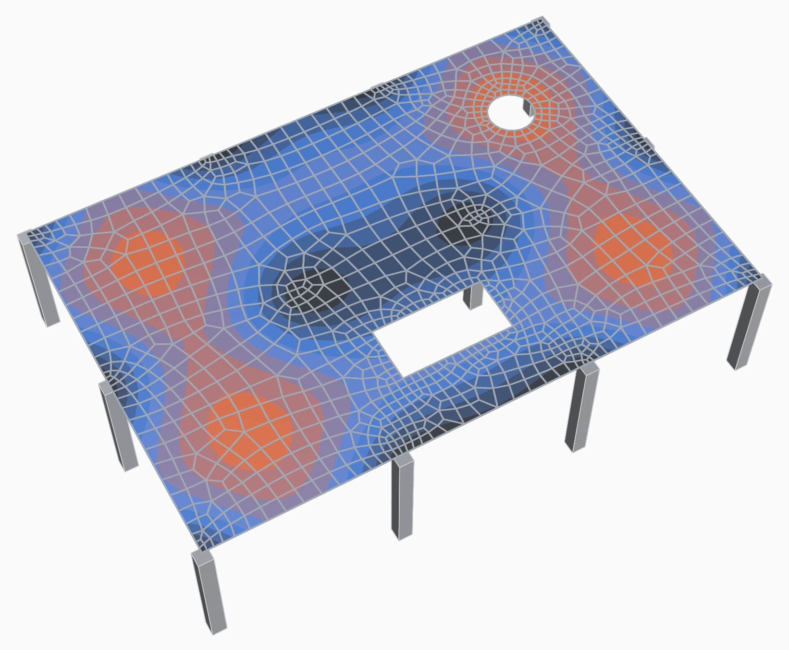

# 🏢 Slab with Openings

<figure><figcaption></figcaption></figure>

[slab-with-openings](slab-with-openings.gh)

A concrete slab 12 m by 8 m and 250 mm thick stands on twelve columns 4 m apart each way and carries 10 kN/m². It has a stair opening 2.4 m by 1.2 m in one bay and a round shaft 1 m across in another. [Mesh Surface](../../docs/basics/utility/mesh-surface.md) meshes it with gmsh. The columns are its inclusion points, so the mesh has a node exactly on each one. Two [Mesh Refinements](../../docs/basics/utility/mesh-refinement.md) make the quads smaller round the columns and along the openings' edges, and the quads grow back gradually away from them. Use it as a template for a slab of your own: the slab's outline and openings, the column points, and a size for each.

Mesh Surface runs gmsh, which you install yourself: see [Setup](../../docs/setup.md#meshing-with-gmsh).

## The model

| Group | What it does |
| --- | --- |
| 1 - Geometry | The sliders: the slab's length and width, the bays each way, the stair opening and the shaft. A Python component gives the slab with its openings, a point at every column, the openings' edges and the slab's area. |
| 2 - Concrete | Two [Mesh Refinements](../../docs/basics/utility/mesh-refinement.md): to 0.1 m round the columns, and to 0.15 m along the openings' edges. [Mesh Surface](../../docs/basics/utility/mesh-surface.md) meshes the slab in quads of 0.4 m, with the columns as **Points**. Concrete is an [nD](../../docs/basics/materials/ND.md) material in a [Plate Fiber Section](../../docs/basics/sections/plate-fiber.md) 250 mm thick, on [ASD Shells](../../docs/basics/elements/shell.md). |
| 3 - Supports | A [Support](../../docs/basics/elements/support.md) at every column, held in X, Y and Z and free to turn. |
| 4 - Loads | 10 kN/m² down on every shell, a [Mesh Load](../../docs/basics/loads/shell-load.md), in a [Load Pattern](../../docs/basics/loads/load-pattern.md). |
| 5 - Analysis | [Assemble](../../docs/basics/assemble.md), with a **Tolerance** of 1 mm, and [Run Analysis](../../docs/basics/analysis/run-analysis.md). The default tolerance, 1 cm, is near the smallest elements and would weld their nodes together. |
| 6 - Results | A [Model View](../../docs/basics/visualisation/model-view.md) of the slab deflected 100 times, coloured by how far it moves in bands, with a [Legend](../../docs/basics/visualisation/legend.md). A second one draws the supports and the loads. |
| 7 - Check | [Reaction Forces](../../docs/basics/results/reaction-forces.md) at the columns, added up, beside the slab's area times the load. |

## The mesh

Mesh Surface lays out triangles in pairs and joins them into quads: here every one of its 1 131 elements is a quad. The quads are 0.4 m across in the middle of the bays, and shrink to 0.1 m round each column, where the slab bends most. Along the openings' edges they're 0.15 m, so the opening and the shaft keep their shape. Each column is a node of the mesh, so its Support takes hold there and nowhere else.

## What it shows

The slab sags most in the middle of its bays, up to about 1 mm, and round the shaft, whose free edge has nothing to hold it. The bay with the stair opening sags less: it has less slab to carry. Over the columns the slab stays level. The twelve columns carry 923.4 kN between them, which is the load on the slab: its area without the openings, 92.3 m², times 10 kN/m².

Try a mesh size at the columns of 0.4 m, the same as the rest, to see the bending round the columns spread. Pick **Triangles** from Mesh Surface's right-click menu, or make the shaft larger.
