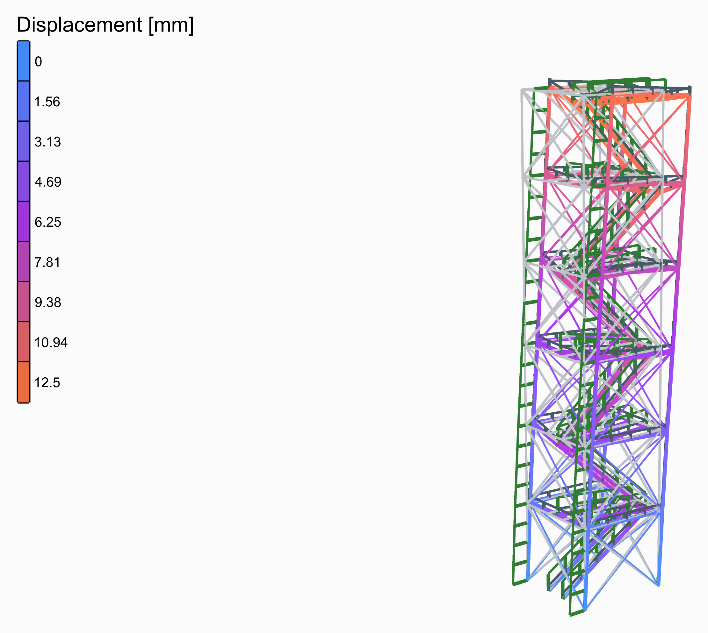
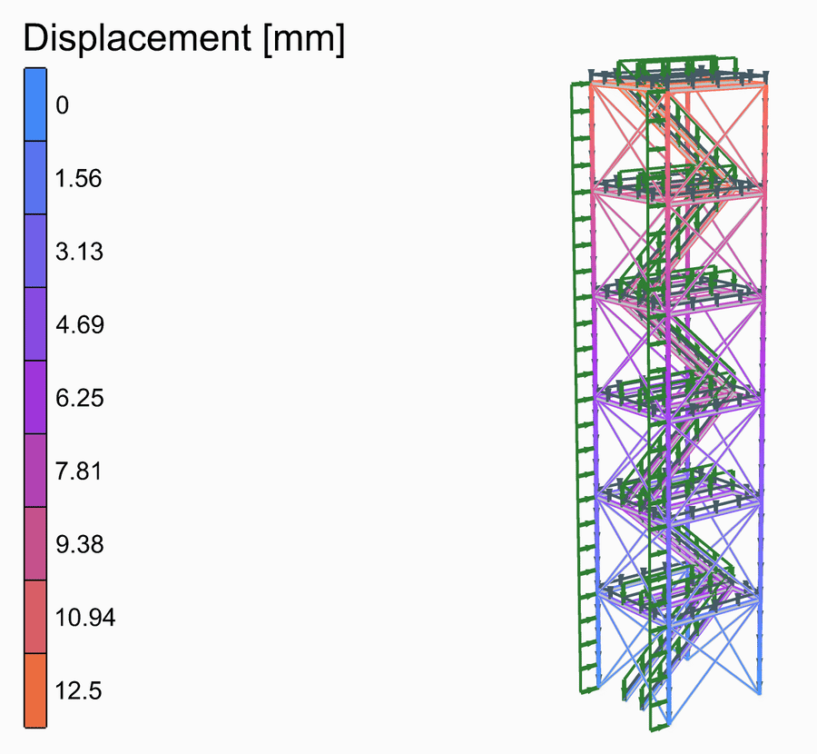
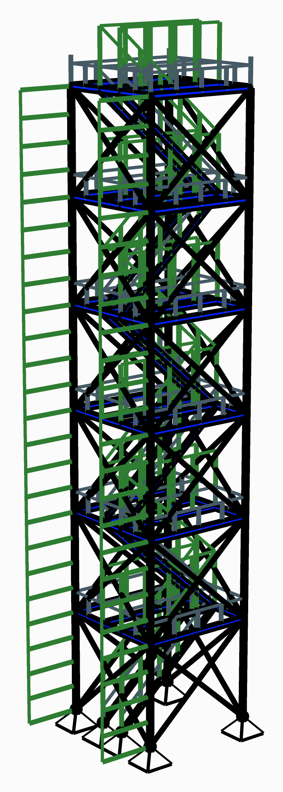
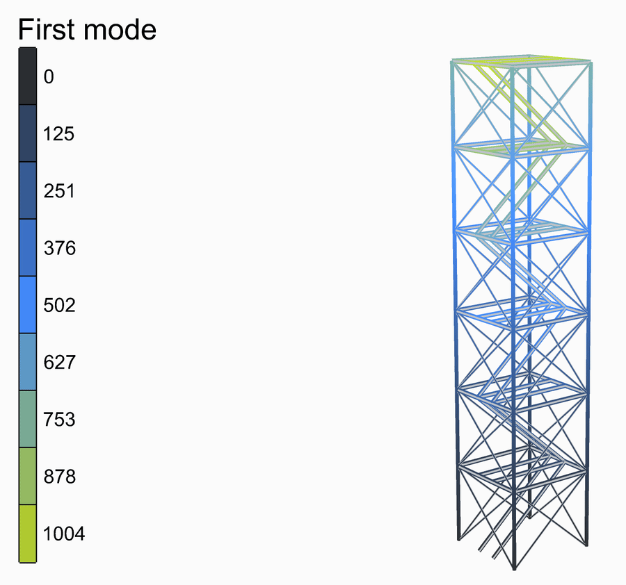

# 🗼 Steel Tower

<figure><figcaption></figcaption></figure>

[steel-tower](steel-tower.gh)

A lattice tower 4 m square and 21 m tall: four tube legs, a landing at every storey, crossed bracing on every face, and a straight flight of stairs climbing each storey along a strip a metre wide across the middle, turning back at each landing. Its width, its storeys and their height are sliders. Beside the static analysis, a natural vibration analysis gives its first six modes.

<figure><figcaption>
The deformed shape, from rest to its full size and back, its loads riding on it.
</figcaption></figure>

## The model

| Group | What it does |
| --- | --- |
| 1 - Geometry | The sliders, and a Python component that draws the geometry from them: the members as lines, each cut where another meets it, the points the structure is held at, and the widths its loads are worked out from. Open the component to see how. Width, levels and storey height. |
| 2 - Members | S355: legs of CHS 168.3x6.3, landings of IPE180, stringers of IPE160, as [ForceBeamColumn](../../docs/basics/elements/force-beam-column.md); the bracing, CHS 76.1x4, as trusses. |
| 3 - Supports | Each leg and the first flight's two stringers pinned at the ground. |
| 4 - Loads | The wind in kN/m² on the windward legs, each over half the tower's width, as a [Linear Load](../../docs/basics/loads/beam-load.md) along +x; people on the stair in kN/m², on each stringer and each beam of the landing strip over half the stair's width; and the own weight. One [Load Pattern](../../docs/basics/loads/load-pattern.md) each. |
| 5 - Analysis | [Assemble](../../docs/basics/assemble.md) and [Run Analysis](../../docs/basics/analysis/run-analysis.md); and a [Natural Vibration Analysis](../../docs/basics/analysis/natural-vibration.md) of the same model, six modes, its frequencies in a panel. |
| 6 - Results | A [Model View](../../docs/basics/visualisation/model-view.md) of the analysed model, deformed and coloured by its displacement, with a [Legend](../../docs/basics/visualisation/legend.md); one of the model at rest, as light grey lines behind it; and one of the supports and the loads. The deformed shape is drawn 120 times its size; a second view draws the first mode. |

## The loads

The wind, 1.0 kN/m², and the people on the stair, 4.0 kN/m², are typed in. Each windward leg takes the wind over half the tower's width as a line load along +x, and each stringer and landing beam the people over half the stair's metre.

<figure><figcaption>
The supports and the loads, as <strong>Model View</strong> draws them: the own weight in its own colour, as OpenSees takes it. Tick <strong>Show Values</strong> in its Loads menu to write what each is worth.
</figcaption></figure>

## What it shows

Under the wind the tower leans 12.5 mm at the top, its stair flights bending under the people. Its first three modes are at 5.3, 5.7 and 7.2 Hz: the second Model View draws the first; change its **Step** to see the others.

<figure><figcaption>
The first mode, 5.3 Hz.
</figcaption></figure>
