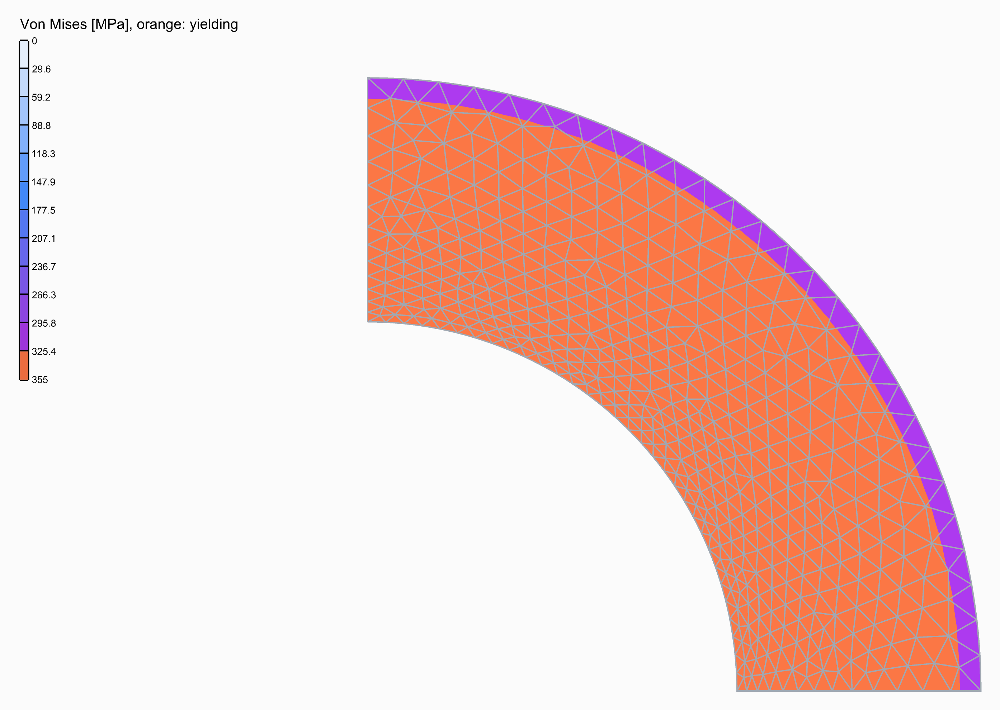
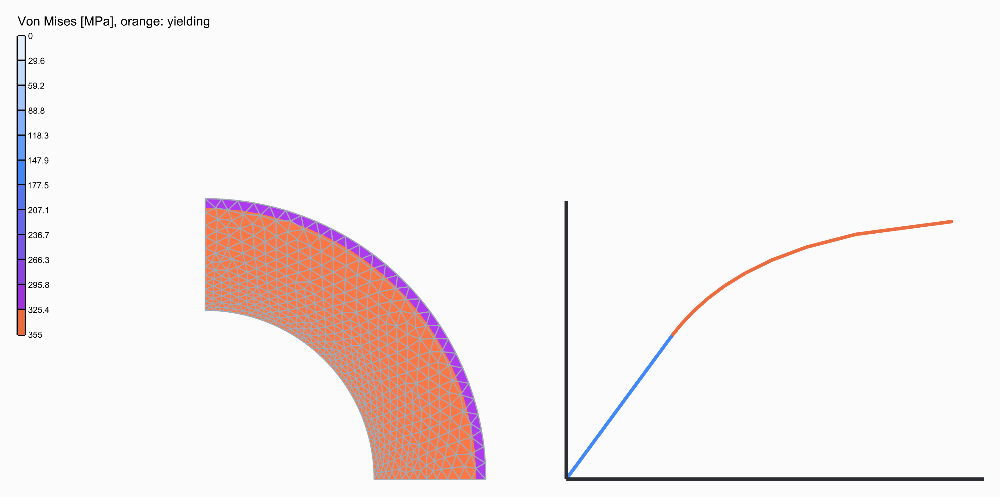
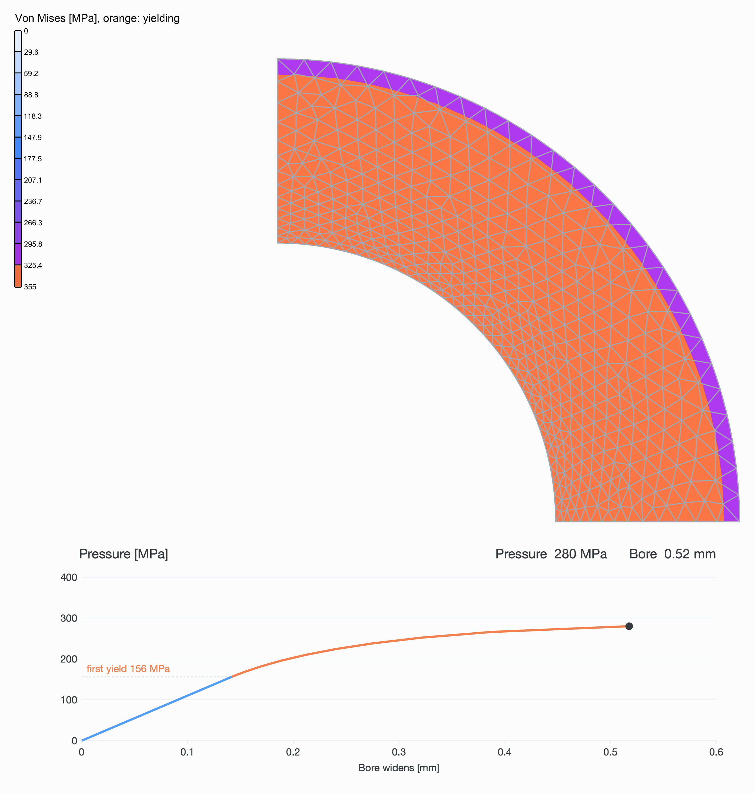

# 🛢️ Thick Pipe under Pressure

<figure><figcaption></figcaption></figure>

[thick-pipe](thick-pipe.gh)

An S355 pipe, bore 200 mm and outside 400 mm, under a pressure inside it. A quarter of a slice 20 mm
long in 4 860 [Ten Node Tetrahedra](../../docs/basics/elements/ten-node-tetrahedron.md), finer at the
bore, in plane strain, as in a long pipe. The steel is the [nD](../../docs/basics/materials/ND.md)
component's **J2Plasticity** unit. Twenty steps take the pressure to 280 MPa.

<figure><video src="thick-pipe-pushing.mp4" autoplay loop muted playsinline></video><figcaption>
The pressure, a step a frame, drawn 60 times its deformation. Orange is steel at yield, spreading out from the bore. Under it, how much the bore widens against the pressure.
</figcaption></figure>

## The model

| Group | What it does |
| --- | --- |
| 1 - The mesh | The tetrahedra as gmsh wrote them: the nodes, and four node numbers per tetrahedron. |
| 2 - Steel | J2Plasticity S355, perfectly plastic, in [Ten Node Tetrahedra](../../docs/basics/elements/ten-node-tetrahedron.md), which carry it best. |
| 3 - Supports | Plane strain: every node held along the pipe. The two cut faces are planes of symmetry, each held across. Three supports on three sets of nodes, none on two. |
| 4 - Load | 280 MPa on the bore, as the forces a six node triangle shares a pressure out as - a third of each face's area on each edge node, none on its corners - [Point Loads](../../docs/basics/loads/point-load.md) in a [Load Pattern](../../docs/basics/loads/load-pattern.md) on a [Linear Time Series](../../docs/basics/time-history/linear.md). |
| 5 - Assemble | [Assemble](../../docs/basics/assemble.md), with a tolerance of 0.5 mm, under the 2.5 mm between the edge nodes. |
| 6 - Pushed in steps | Newton and 20 steps of [Load Control](../../docs/basics/analysis/integrator.md) of 5%. |
| 7 - Von Mises | A [Model View](../../docs/basics/visualisation/model-view.md) of the Von Mises stress at the **Step** the slider picks, in Alpaca4d's colours, orange where the steel yields. |
| 8 - The curve | [Nodal Displacements](../../docs/basics/results/nodal-displacements.md) and [Brick Stresses](../../docs/basics/results/brick-stresses.md) at every step, and a Python component that draws how much the bore widens against the pressure: light blue while every point is elastic, orange after. |

<figure><figcaption>
As the example opens: the pipe, and the curve Grasshopper draws beside it.
</figcaption></figure>

## What it shows

A pressure inside a thick pipe stretches its wall round the circumference, hardest at the bore. So the
steel yields there first, at p = Fy / √3 (1 - a² / b²) = 154 MPa with a = 100 and b = 200 mm, the
radii. The model shows it at 156 MPa.

From there a ring of yielded steel grows outwards, its edge at the radius c where
p = Fy / √3 (1 - c² / b² + 2 ln(c / a)). The pipe has nothing more to give when the ring reaches the
outside, at p = 2 Fy / √3 ln(b / a) = 284.1 MPa. Pushed on in OpenSees, the same model levels off at
284.0, 0.05% under; at 280 MPa, as here, a thin ring at the outside is still elastic.

That pressure is the basis of a pipe's or a pressure vessel's limit design, and of autofrettage, which
pushes a gun barrel or a high-pressure line past first yield on purpose, so that the yielded bore is
left in compression when the pressure comes off.

<figure><figcaption>
The pipe at 280 MPa, and the whole curve.
</figcaption></figure>

## Try

- Move **Step** to watch the ring of yielded steel grow from the bore.
- A thinner wall: b / a nearer 1, and first yield and collapse come closer together.
- **Load** past 284 MPa, and the analysis stops converging: the whole wall has yielded.
- The tetrahedra need an OpenSees built from the master branch since 16 October 2026 (Alpaca4d >
  Settings > Set OpenSees Executable). The model has 4 860 elements, so it needs a license.
