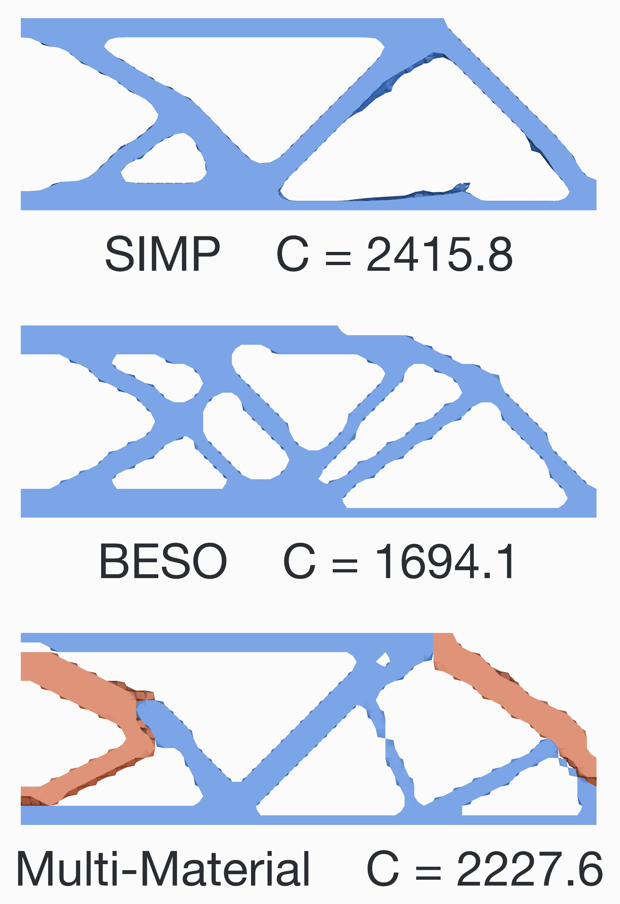
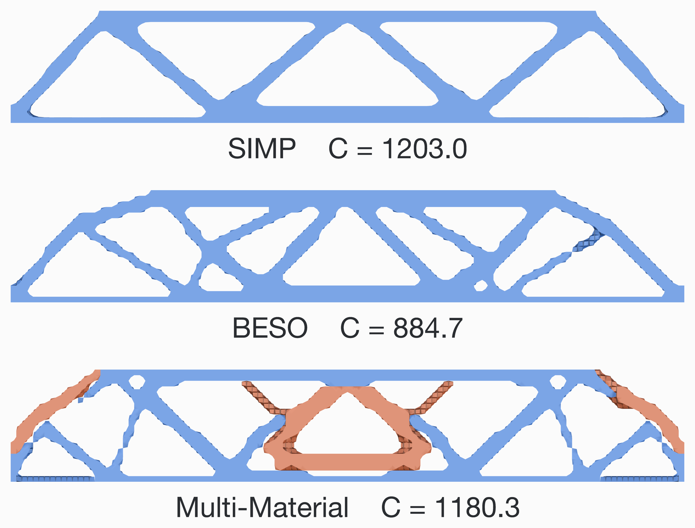

# 🧪 Topology Benchmarks

<figure><figcaption></figcaption></figure>

<figure><figcaption></figcaption></figure>

[topology-benchmarks](topology-benchmarks.gh)

The two benchmarks of [Topology Optimisation](../../docs/basics/optimisation/topology-optimisation.md),
ready to run, each by its three methods side by side. Both are problems from top3d (Liu and Tovar,
2014), set up in its units: a unit modulus, Poisson 0.3, unit cubes and loads of 1.

- **SIMP** runs with top3d's settings: 30% of the volume, a penalty of 3, a filter radius of 1.5
  and at most 200 iterations. Beside it are panels giving the compliance that Alpaca4d's test bench
  and top3d reach after 200 iterations, to compare with.
- **[BESO](../../docs/basics/optimisation/topology-optimisation.md#beso)** carves the block down
  to the same 30%, every brick solid or void all along.
- **[Multi-Material](../../docs/basics/optimisation/topology-optimisation.md#multi-material)**
  shares the 30% between the unit material, 18%, and one half as stiff, 12%.

BESO and Multi-Material use top3d's filter radius of 1.5 too. Each problem has one **Run** toggle
for its three methods.

::: info
Without a license, Topology Optimisation runs on models of up to 500 elements, so these two, of
4 800 and 9 600 bricks, need one.
:::

## The model

| Group | What it does |
| --- | --- |
| 1 - top3d's material | An [nD](../../docs/basics/materials/ND.md) material with E = 1 and ν = 0.3, and a second one half as stiff, E = 0.5, for Multi-Material. |
| 2 - Cantilever | 60 x 4 x 20 unit [SSP Bricks](../../docs/basics/elements/brick.md), held at every node of its left end. A [Point Load](../../docs/basics/loads/point-load.md) of -1 acts at each node of the bottom edge of the free end. This is top3d's own example, `top3d(60,20,4,0.3,3,1.5)`. |
| 3 - Simply supported beam | 120 x 4 x 20 bricks, built to the right of the cantilever so that their designs do not overlap. They are pinned along the bottom edge of the left end and on rollers, free along X, along the bottom edge of the right end. A load of -1 acts at each node of the top edge at mid-span. |
| 4 - Cantilever, three ways | [Assemble](../../docs/basics/assemble.md), then three Topology Optimisation components on its methods, all started by **Run Cantilever** and stepped back by **Step Cantilever**. Beside SIMP, panels show its last compliance, the iterations run, what to expect and the history; beside BESO and Multi-Material, their last compliance. |
| 5 - Simply supported, three ways | The same for the simply supported beam. |
| 6 - The designs one above the other | For each problem, SIMP's design at the top and BESO's under it, moved up with **Move**; Multi-Material draws its own where the model is, each material in its colour. Each is named with a **Text Tag 3D**. |

## Running them

1. Set **Run Cantilever** to `true`. Its three runs go together, each on its own thread, and the
   designs draw as they go. SIMP ends after 200 iterations: neither problem reaches top3d's
   tolerance of 0.01 before then, and neither does top3d.
2. Compare **Compliance, last iteration** with the panels beside it: 2415.86 from Alpaca4d's test
   bench and 2415.82 from top3d.
3. Do the same for the simply supported beam with **Run Simply supported**. Both values are
   1203.026.
4. Drag a **Step** slider back to watch that problem's runs again, design by design.

With both problems running at once on an Apple M2 Pro, the cantilever's three runs end within two
minutes and the simply supported beam's within four.

## What to expect

| Problem | Method | Iterations | Compliance |
| --- | --- | --- | --- |
| Cantilever | SIMP | 200 | 2415.8 |
| | BESO | 69 | 1694.1 |
| | Multi-Material | 265 | 2227.6 |
| Simply supported | SIMP | 200 | 1203.0 |
| | BESO | 82 | 884.7 |
| | Multi-Material | 263 | 1180.3 |

- SIMP's cantilever ends as a top flange and a bottom flange joined by diagonal webs, and its simply
  supported beam as a truss, with its tie thickest at mid-span.
- SIMP's first iterations agree with top3d to round-off. The two cantilever runs part by up to 0.2%
  around iteration 70, while the design rearranges itself, and then come back together.
- BESO finds the same kinds of truss with more, thinner members. Its compliance is the lowest
  because its design is solid or void: SIMP's compliance is that of its grey densities, penalised
  at a power of 3.
- Multi-Material puts the softer material where it can be thick: in the cantilever, in the V at
  the support and the diagonal down to the load; in the simply supported beam, round the middle
  panel under the load.

The numbers, and the comparison of each SIMP design with top3d's, are on the
[Topology Optimisation](../../docs/basics/optimisation/topology-optimisation.md) page.
