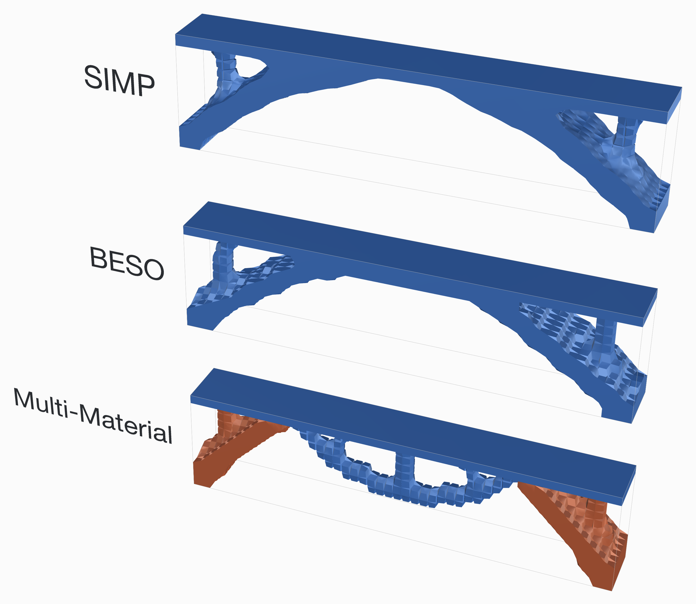
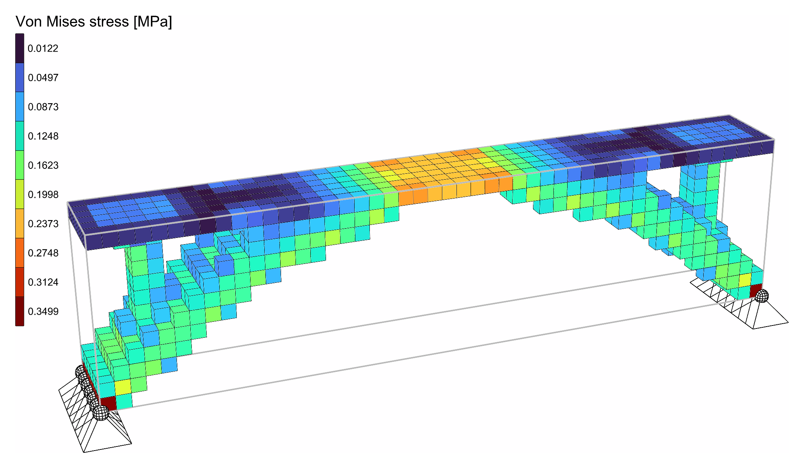
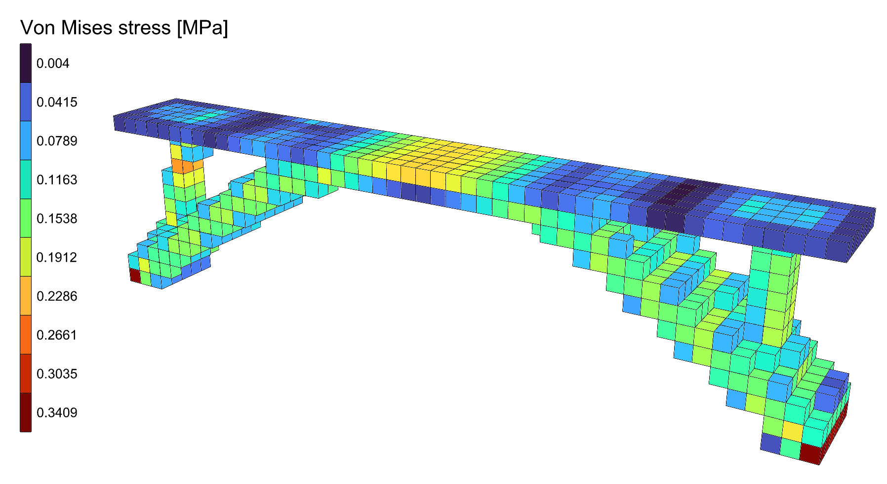
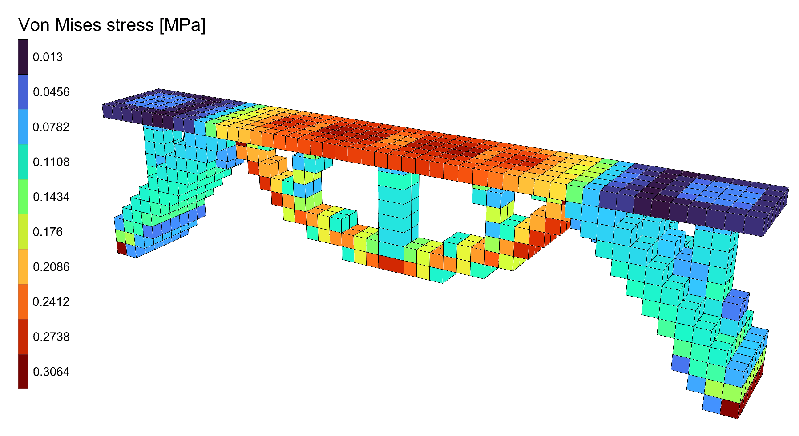

# 🌈 Topology Bridge

<figure><figcaption></figcaption></figure>

[topology-bridge](topology-bridge.gh)

Where a bridge needs its material, found in a block of bricks by the three methods of
[Topology Optimisation](../../docs/basics/optimisation/topology-optimisation.md), side by side on
the same model. The design domain is a steel block 16 m long, 2 m wide and 4 m high, pinned along
both ends of its bottom. Its top layer is the deck: it carries 10 kN/m² and stays solid, whatever
the optimisation finds. Each method keeps a fifth of the rest:

- **SIMP** gives each brick a density between 0 and 1;
- **[BESO](../../docs/basics/optimisation/topology-optimisation.md#beso)** carves the block down, every brick
  solid or void all along;
- **[Multi-Material](../../docs/basics/optimisation/topology-optimisation.md#multi-material)** chooses, brick by
  brick, between steel (E = 210 GPa) and concrete (E = 33 GPa), with at most 5% of the block in
  steel and 15% in concrete.

::: info
Without a license, Topology Optimisation runs on models of up to 500 elements. At 3 bricks per
metre this one has 3 456, so it needs one; at 1 brick per metre, 128 bricks, it runs without.
:::

## The model

| Group | What it does |
| --- | --- |
| 1 - How fine | **Bricks per metre**, the same every way. The Expressions turn it into the bricks along and across, the height of a layer and the number of levels. |
| 2 - The design domain and the deck | The plan, a 16 x 2 m rectangle, meshed once with **Mesh Plane**, copied up level by level and made into bricks between each pair of levels by [Mesh Series to Brick](../../docs/basics/utility/mesh-series-to-brick.md). The domain runs from the bottom to the deck's underside; the deck is the one layer above. |
| 3 - Steel and concrete, and the bricks | Two [nD](../../docs/basics/materials/ND.md) materials: steel, E = 210 GPa and ν = 0.3, and concrete C30/37, E = 33 GPa and ν = 0.2, for Multi-Material. The bricks, steel, are two sets of [SSP Bricks](../../docs/basics/elements/brick.md), named **Domain** and **Deck** through their ElementId. |
| 4 - Pinned ends, and the deck load | The nodes along the bottom of both ends, held in X, Y and Z by a [Support](../../docs/basics/elements/support.md) and free to rotate. The deck load, 10 kN/m² over 32 m², shared equally among the nodes of the deck's top as [Point Loads](../../docs/basics/loads/point-load.md), in a [Load Pattern](../../docs/basics/loads/load-pattern.md). |
| 5 - Assemble Model | [Assemble](../../docs/basics/assemble.md). [Model View](../../docs/basics/visualisation/model-view.md) is disabled: enable it to see the domain, the supports and the loads. |
| 6 - Three ways | Three Topology Optimisation components on the same model, **Keep** naming the Deck for all three. **SIMP**: **VolumeFraction** 0.2, **Iterations** 100. **BESO**: the same VolumeFraction, Iterations 200. **Multi-Material**: **Materials** the steel and the concrete, **VolumeFractions** the **Steel share**, 0.05, and the **Concrete share**, 0.15, Iterations 300. Each has its own **Run** and **Step**, and panels showing its compliance and whether it converged. |
| 7 - The designs one above the other | SIMP's design at the top and BESO's under it, moved up with **Move**; Multi-Material draws its own where the model is, each material in its colour, steel blue and concrete orange. Each is named with a **Text Tag 3D**. |
| 8 - Each design, analysed | For each method, [Run Analysis](../../docs/basics/analysis/run-analysis.md) on its **AlpacaModel**, the design as a model of its own, and a [Model View](../../docs/basics/visualisation/model-view.md) colouring it by Von Mises stress, with a Legend. They are disabled: enable one method's Run Analysis and Legend once its run has stopped. |

## Running it

1. Set **Run SIMP**, **Run BESO** and **Run Multi-Material** to `true`, together or one after the
   other. Each run goes on its own thread, so Rhino stays free, and its design draws in group 7
   as it goes. Run together at 3 bricks per metre on an Apple M2 Pro, SIMP converges after 77
   iterations in 15 seconds, BESO after 105 in 19 seconds, and Multi-Material after 265 in about
   80 seconds.
2. Set a **Run** to `false` to pause it, and back to `true` to go on. Changing anything else, such
   as **VolumeFraction**, the shares or **Bricks per metre**, starts the runs again.
3. Drag a **Step** slider back to watch that run design by design: every iteration is kept. BESO's
   steps are bridges of their own, from the whole block down to a fifth of it.
4. Once a run has stopped, select its **Run Analysis** and **Legend** in group 8 and enable them.
   The design is analysed as it would be built, and Model View colours it by Von Mises stress where
   the model is, so enable one method at a time. Disable Run Analysis again before dragging its
   **Step**, or every design shown is analysed.

## What it shows

| Method | Iterations | Compliance (kNm) | The design |
| --- | --- | --- | --- |
| SIMP | 77 | 0.00427 | An arch from support to support, rising into the deck, with a column near each end |
| BESO | 105 | 0.00321 | Two raking legs from the supports into the deck, with a column near each end |
| Multi-Material | 265 | 0.01056 | Concrete legs from the supports to the deck, a steel arch slung under its middle |

The compliance is the work done by the deck load: the lower, the stiffer. SIMP's is that of
densities between 0 and 1, which it penalises, not of a design built solid and void; BESO's
design is solid or void all along. Multi-Material's bridge is three quarters concrete, six times
softer than steel.

### SIMP

<figure><figcaption></figcaption></figure>

At 3 bricks per metre, the steel forms an arch, with a column at each end carrying the deck down
to the supports.

At 2 bricks per metre, the deck is a 0.5 m slab of solid steel, stiff enough to span most of the
way by itself. The steel then goes into two legs that shorten its span, rather than into an arch.
What is best depends on what is already there. At 4 bricks per metre, the block has 8 192 bricks,
and the run takes under a minute.

### BESO

<figure><figcaption></figcaption></figure>

The steel goes into two inclined legs that rise from the supports into the deck, with a column up
to the deck near each end: a deck on two raking struts, every brick of it solid, with no grey
density to threshold. **Volume** comes down from 1 to 0.2 in about 80 iterations; then the design
settles. Early on, the block opens a hole above mid-span and the underside comes away from the
supports; by half the volume the legs are there, and the rest of the run thins them.

### Multi-Material

<figure><figcaption></figcaption></figure>

The concrete goes into two broad legs that rise from the supports to the deck, a quarter of the
way in from each end. The steel goes into an arch slung under the middle of the deck, hung from
it by a column at mid-span. Concrete is six times softer than steel, so it is used where it can be
thick; the little steel there is goes where the deck needs stiffening most.

The densities sharpen to one material or none every 50 iterations, so the compliance jumps a
little each time; the design only becomes clear after iteration 200 or so. Only stiffness is
optimised, and only the Young's moduli count. The steel ends up under the deck because that is
where it stiffens most for its volume, not because it is good in tension: change the shares and
see how the split moves.
