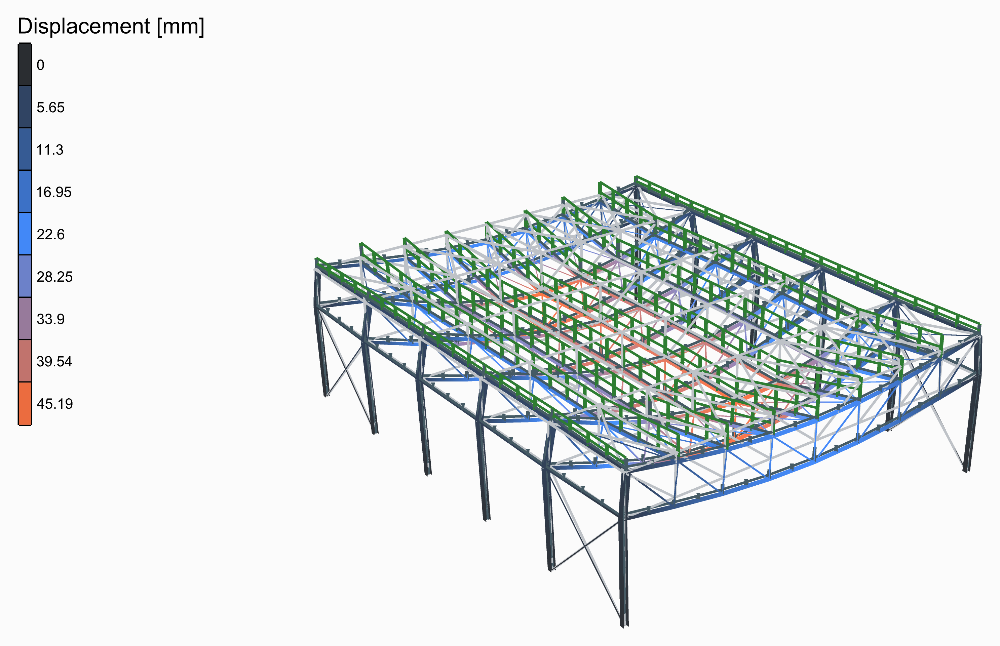
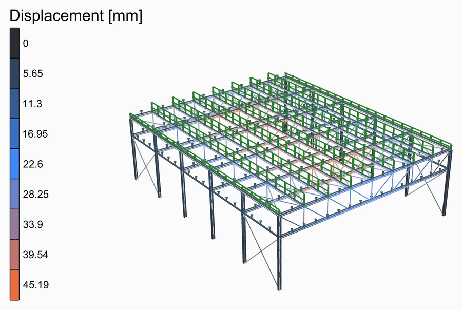
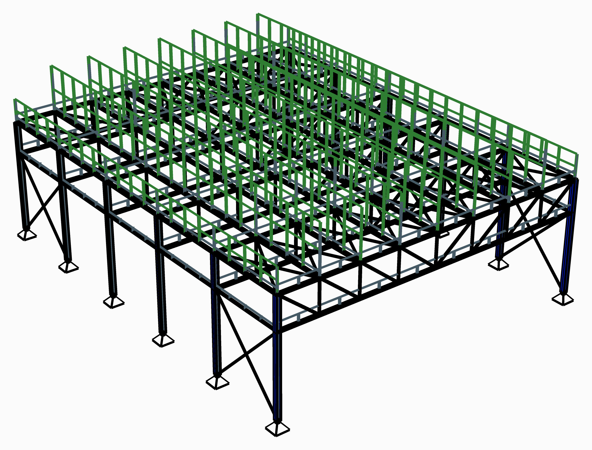

# 🏭 Truss Roof Hall

<figure><figcaption></figcaption></figure>

[truss-roof-hall](truss-roof-hall.gh)

A steel hall 24 m across and 30 m long: six frames, each a Pratt truss 2.4 m deep on two HEA300 columns, 6 m apart, joined by IPE180 purlins at the trusses' top nodes. The columns rise to the top chord and the bottom chord meets them at the eaves, so each frame stands on pinned feet. Crosses in the two end bays, in the roof and in the long walls, hold the hall lengthways, with a strut along each wall at the eaves. Every dimension is a slider.

<figure><figcaption>
The deformed shape, from rest to its full size and back, its loads riding on it.
</figcaption></figure>

## The model

| Group | What it does |
| --- | --- |
| 1 - Geometry | The sliders, and a Python component that draws the geometry from them: the members as lines, each cut where another meets it, the points the structure is held at, and the widths its loads are worked out from. Open the component to see how. Span, bays, frame spacing, eaves height, truss depth and panels. |
| 2 - Members | S355 from [Material Library Elastic](../../docs/basics/materials/MaterialDatabase.md) and sections from [Steel Section Library](../../docs/basics/sections/library.md): HEA300 columns, HEA160 chords and struts of CHS 114.3x5 as [ForceBeamColumn](../../docs/basics/elements/force-beam-column.md); the webs, CHS 88.9x5, and the bracing, CHS 60.3x4, as its Truss type, bars that only pull or push. |
| 3 - Supports | Each column pinned at its foot, a [Support](../../docs/basics/elements/support.md). |
| 4 - Loads | The roof finishes and the snow, in kN/m², times the width of roof each purlin carries, as [Linear Load](../../docs/basics/loads/beam-load.md)s; the [Gravity Load](../../docs/basics/loads/gravity.md); and two [Load Pattern](../../docs/basics/loads/load-pattern.md)s with the ultimate limit state's factors, 1.35 on what is permanent and 1.5 on the snow. |
| 5 - Analysis | [Assemble](../../docs/basics/assemble.md), Analysis Settings and [Run Analysis](../../docs/basics/analysis/run-analysis.md). |
| 6 - Results | A [Model View](../../docs/basics/visualisation/model-view.md) of the analysed model, deformed and coloured by its displacement, with a [Legend](../../docs/basics/visualisation/legend.md); one of the model at rest, as light grey lines behind it; and one of the supports and the loads. The deformed shape is drawn 60 times its size. |

## The loads

The roof finishes, 0.5 kN/m², and the snow, 1.0 kN/m², are typed in, worked out to your code of practice beforehand: Alpaca4d puts them on the purlins, each times the width of roof it carries, a panel of the truss, or half of one over the eaves. The frames' own weight is the Gravity Load's, a uniform load along each beam and half on each end of a truss.

<figure><figcaption>
The supports and the loads, as <strong>Model View</strong> draws them: the own weight in its own colour, as OpenSees takes it. Tick <strong>Show Values</strong> in its Loads menu to write what each is worth.
</figcaption></figure>

## What it shows

The trusses sag most in the middle bays, 45 mm under the factored loads, about span/530; the end
frames, carrying half a bay each, less. Widen the span, make the trusses shallower or the frames further apart, and watch the sag grow. For a deflection check, set both patterns' factors to 1.
