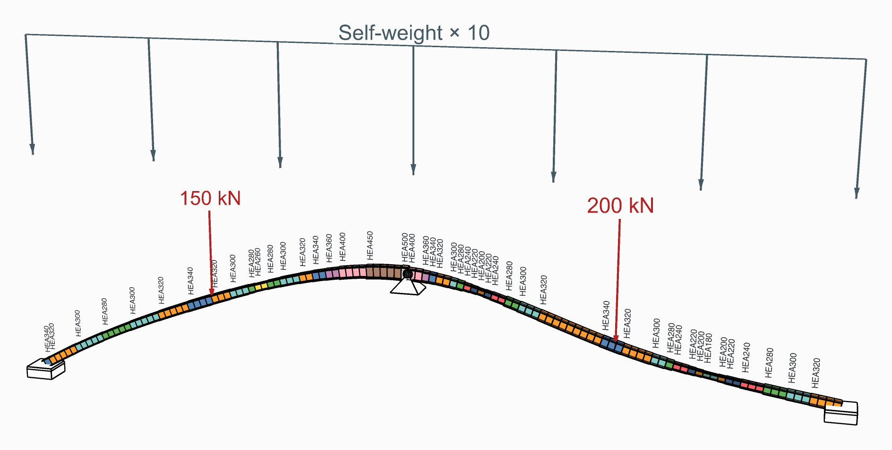

# 🌉 Two-Span Beam

<figure><figcaption></figcaption></figure>

[two-span-beam](two-span-beam.gh)

A curve about 30 m long rises and falls in a vertical plane. A point along it splits it into two
spans, each cut into elements about 25 cm long. The beam is built in at both ends and pinned
between the spans, HEA300 in S235 to begin with, under ten times its own weight and two point
loads, 150 kN and 200 kN, which sliders move along it. A
[Section Optimiser](../../docs/basics/optimisation/section-optimiser.md) with one
[Design Group](../../docs/basics/optimisation/design-group.md) over the whole beam sizes it from a
list of HEAs.

## The model

| Group | What it does |
| --- | --- |
| 1 - The beam | The curve's points, where the middle support is, and where the two loads are and what they are worth: the things to try. |
| 2 - Geometry | The curve, split at the middle support, each span divided into elements of about 25 cm, so that each span ends on a node. |
| 3 - Member | HEA300 in S235, from [Material Library Elastic](../../docs/basics/materials/MaterialDatabase.md) and [Steel Section Library](../../docs/basics/sections/library.md), every element with the ElementId `Beam`. |
| 4 - Supports and loads | Built in at both ends, pinned between the spans; the two point loads, each at the node closest to its slider, and ten times the self-weight, in one [Load Pattern](../../docs/basics/loads/load-pattern.md). |
| 5 - Model | [Assemble](../../docs/basics/assemble.md). |
| 6 - Section Optimiser, one design group over the whole beam | The HEAs in the order to try them, and **Uniform**: off, as it opens, each element takes the first that it can have; on, the whole beam takes the first that every element can have. |
| 7 - The HEA named where it changes | Text tags along the beam, wherever the section changes. |
| 8 - Deformed shape, bending moment and shear | A second [Model View](../../docs/basics/visualisation/model-view.md): the sized beam's deformed shape, coloured by its displacement, with a [Legend](../../docs/basics/visualisation/legend.md), and its bending moment and shear. |

## What it shows

Element by element, the HEA grows towards the middle support and under each load, where the
moments are largest, and shrinks where they cross zero. Turn **Uniform** on and the whole beam
takes the section its worst element needs. Move the loads and the sections follow them.
