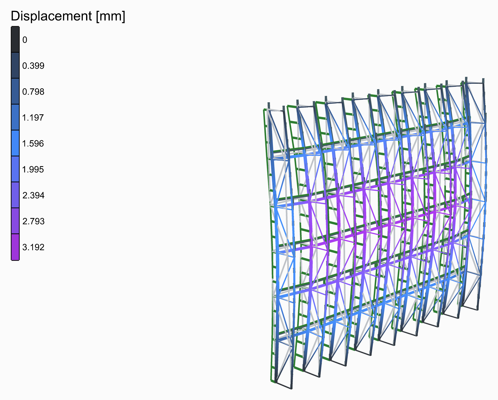
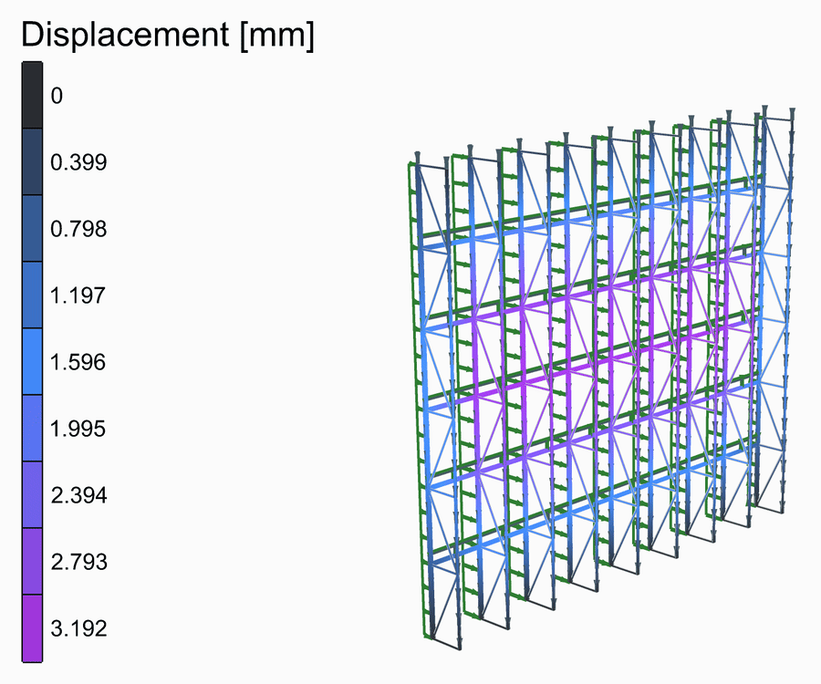
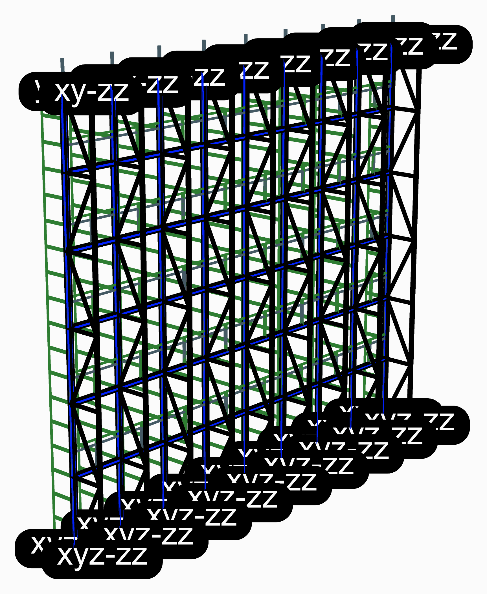

# 🏢 Vertical Truss Facade

<figure><figcaption></figcaption></figure>

[vertical-truss-facade](vertical-truss-facade.gh)

A glass wall 12 m wide and 10.8 m tall, held only at its foot and its top, as a lobby's is: mullions every 1.5 m and transoms between them every 1.8 m. Behind every mullion a vertical truss stiffens it against the wind: the mullion is its outer chord, a tube 0.9 m behind it the inner chord, with a post at every transom and diagonals zig-zagging between. A slider puts a truss behind every second, third or fourth mullion instead.

<figure><figcaption>
The deformed shape, from rest to its full size and back, its loads riding on it.
</figcaption></figure>

## The model

| Group | What it does |
| --- | --- |
| 1 - Geometry | The sliders, and a Python component that draws the geometry from them: the members as lines, each cut where another meets it, the points the structure is held at, and the widths its loads are worked out from. Open the component to see how. Bays, bay width, height, transom levels, truss depth, and how many mullions a truss. |
| 2 - Members | S355: mullions of RHS 120x60x4, their depth across the wall, transoms of RHS 100x50x4 and inner chords of CHS 76.1x4 as [ForceBeamColumn](../../docs/basics/elements/force-beam-column.md); the posts and diagonals, CHS 48.3x4, as trusses. |
| 3 - Supports | The mullions and the inner chords stand on their feet; at the top, both are held across the wall, and the inner chords along it as well. |
| 4 - Loads | The wind in kN/m², times the width of wall each mullion catches, as a [Linear Load](../../docs/basics/loads/beam-load.md) along +y; the glass in kN/m² on the transoms, times the height of glass each carries; and the own weight. |
| 5 - Analysis | [Assemble](../../docs/basics/assemble.md) and [Run Analysis](../../docs/basics/analysis/run-analysis.md). |
| 6 - Results | A [Model View](../../docs/basics/visualisation/model-view.md) of the analysed model, deformed and coloured by its displacement, with a [Legend](../../docs/basics/visualisation/legend.md); one of the model at rest, as light grey lines behind it; and one of the supports and the loads. The deformed shape is drawn 200 times its size. |

## The loads

The wind, 1.2 kN/m², is typed in and put on the mullions, each times the width of wall it catches: a bay, or half of one at the two ends. The glass, 0.5 kN/m², hangs on the transoms.

<figure><figcaption>
The supports and the loads, as <strong>Model View</strong> draws them: the own weight in its own colour, as OpenSees takes it. Tick <strong>Show Values</strong> in its Loads menu to write what each is worth.
</figcaption></figure>

## What it shows

The wall bows in the middle of its height, between its foot and its top, by 3.2 mm: the trusses span the whole 10.8 m. Put a truss behind every second mullion and the transoms must carry the wind across to them: the wall bows between the trusses as well.
