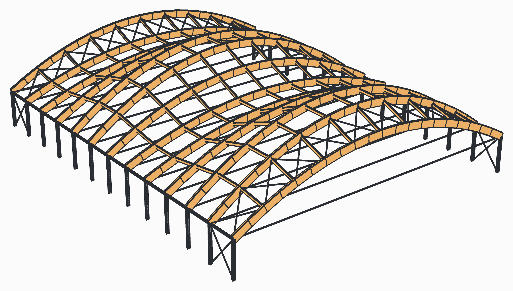
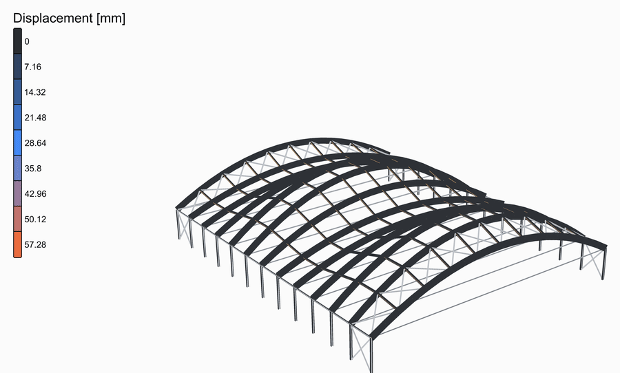
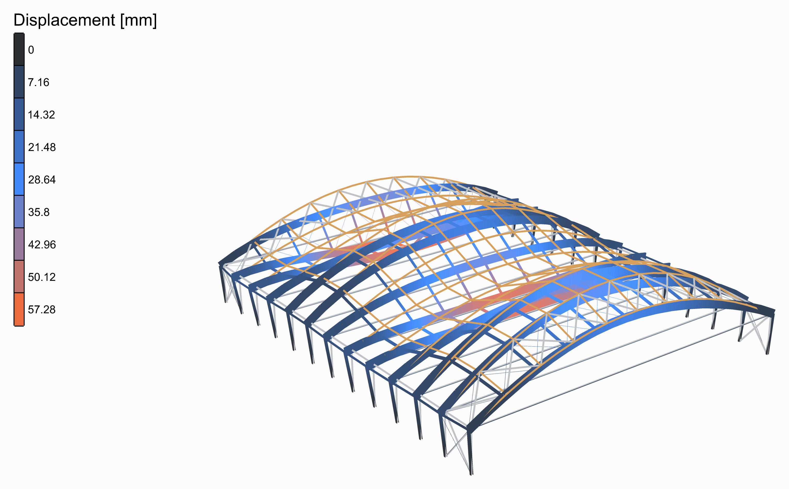
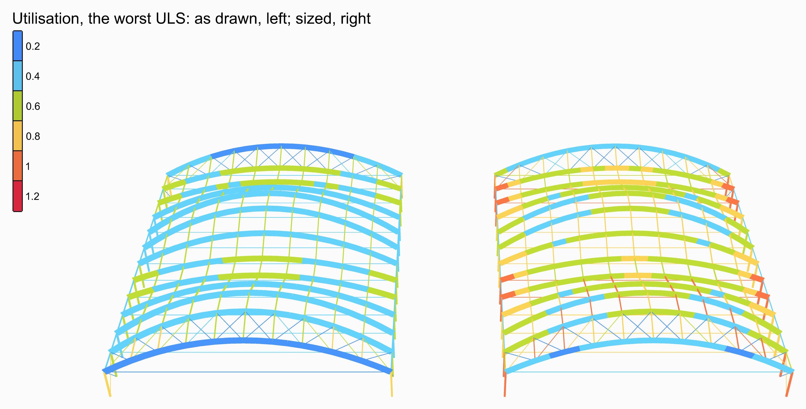

# 🌊 Wave Roof Hall

<figure><figcaption></figcaption></figure>

[wave-roof-hall](wave-roof-hall.gh)

A hall 50 m across and 60 m long, timber and steel together. Thirteen glulam arches, 5 m apart, span from column head to column head as parabolas; their rise swings between 5.3 and 9.7 m along the hall, so the roof rolls in waves from one end to the other. Glulam purlins run from arch to arch. Steel holds it all up and steady: HEB columns built in across the hall, a round tie rod under every arch taking its thrust, HEA eave beams along the column heads, and crosses of round bars in the walls and the roof of the two end bays, which work in tension only. Every dimension is a slider.

Each member is checked to the code of its material — the glulam to EN 1995-1-1, the steel to EN 1993-1-1 — over six ULS combinations, timber with the k_mod of each combination's loads. Then one Section Optimiser sizes the timber and the steel together.

<figure><figcaption>
SLS 1, the permanent load and the snow, drawn 100 times its size.
</figcaption></figure>

## The model

| Group | What it does |
| --- | --- |
| 1 - Geometry | The sliders, and a Python component that draws the hall from them: the members as lines, the points it stands on, the widths its loads are worked out from, and the lengths its checks need. Span, length, arch spacing, column height, the arches' mean rise, how far the wave lifts and lowers it and its wavelength along the hall. |
| 2 - Members | GL30h 240 × 1200 arches and GL24h 140 × 400 purlins, from [Material Library Elastic](../../docs/basics/materials/MaterialDatabase.md) and [Rectangular](../../docs/basics/sections/rectangular.md) sections, drawn in wood colour. S355 HEB 300 columns and HEA 200 eave beams from the [Steel Section Library](../../docs/basics/sections/library.md), 80 mm tie rods and 30 mm bars, [Circular](../../docs/basics/sections/circular.md) and solid; the rods and the bars as the beam's Truss type, the bars in tension only. Every member has an ElementId the checks pick it by: Arch, Purlin, Column, Eave, Tie, WallBrace, RoofBrace. |
| 3 - Supports | The columns built in across the hall and pinned along it, where the crosses in the walls hold them, a [Support](../../docs/basics/elements/support.md). |
| 4 - Loads | Four [Load Pattern](../../docs/basics/loads/load-pattern.md)s, each named and with the duration timber's k_mod is set by in its **Duration** menu: G permanent — the own weight and 0.5 kN/m² of roof build-up; S short-term — 1.0 kN/m² of snow; Wx and Wy instantaneous — 0.7 kN/m² of wind pressure and 0.4 kN/m² of suction across the hall and on the gables. Each load in kN/m², times the width of roof, wall or gable each member carries. |
| 5 - Model | [Assemble](../../docs/basics/assemble.md), and Analysis Settings. |
| 6 - Load combinations | Six ULS combinations and two SLS ones to EN 1990, a line each in three panels, added to the model by one [Load Combination](../../docs/basics/loads/load-combination.md). |
| 7 - Analysis | [Run Analysis](../../docs/basics/analysis/run-analysis.md) solves every combination and hands on one model that holds them all. |
| 8 - Views | The hall in its materials; and one combination deformed, picked by its place — SLS 1 as it opens — over the hall at rest, with a [Legend](../../docs/basics/visualisation/legend.md). |
| 9 - Checks | Four [Utilisation](../../docs/basics/results/utilisation.md)s over the ULS combinations, a branch each: on the **Timber** type the arches and the purlins, on the **Steel** type the columns and the rest; their largest utilisation, the arches' k_mod of each combination, and the largest displacement under SLS 1. |
| 10 - Sizing | Lists of sections, a [Design Group](../../docs/basics/optimisation/design-group.md) for each kind of member, and two [Section Optimiser](../../docs/basics/optimisation/section-optimiser.md)s over the six ULS combinations: one stopped after its first iteration, which checks the hall as drawn, and one that sizes it. Each one's utilisation is drawn as a plot, the sized hall beside the one as drawn. |

## Loads and combinations

| Combination | Type | Formula | k_mod |
| --- | --- | --- | --- |
| ULS 1 | ULS | 1.35 G | 0.6 |
| ULS 2 | ULS | 1.35 G + 1.5 S | 0.9 |
| ULS 3 | ULS | 1.35 G + 1.5 S + 0.9 Wx | 1.1 |
| ULS 4 | ULS | 1.35 G + 0.75 S + 1.5 Wx | 1.1 |
| ULS 5 | ULS | 1.35 G + 0.75 S + 1.5 Wy | 1.1 |
| ULS 6 | ULS | G + 1.5 Wx | 1.1 |
| SLS 1 | SLS characteristic | G + S | — |
| SLS 2 | SLS quasi-permanent | G | — |

The factors are EN 1990's, Table A1.2(B), with ψ0 = 0.5 for snow below 1000 m and 0.6 for wind. ULS 1, the permanent load alone, is there for the timber: its k_mod is lowest under it, 0.6 in service class 1, and it can govern a member that the snow, at 0.9, and the wind, at 1.1, do not. Each combination takes the k_mod of the shortest duration among its own patterns, as EN 1995-1-1 3.1.3(2) says: no k_mod is typed anywhere, only each pattern's Duration.

## The checks

| Members | Section | Largest | Under | By |
| --- | --- | --- | --- | --- |
| Arches | GL30h 240 × 1200 | 0.51 | ULS 2, snow | (6.24), buckling in their plane |
| Purlins | GL24h 140 × 400 | 0.71 | ULS 5, wind on the gables | (6.23) |
| Columns | HEB 300 | 0.64 | ULS 5 | torsion |
| Ties, crosses, eaves | 80 mm rods, 30 mm bars, HEA 200 | 0.66 | ULS 5 | a wall cross in tension |

The arches are held sideways at every purlin, about 6 m apart, and buckle in their plane over 0.6 of their length; the columns buckle across the hall as cantilevers, twice their height. Under SLS 1 the hall sags 57 mm at most, in the middle of the three lowest arches: span/870.

<figure><figcaption>
SLS 1, deformed 100 times, over the hall at rest: the arches of least rise sag most.
</figcaption></figure>

## Sizing timber and steel together

One [Section Optimiser](../../docs/basics/optimisation/section-optimiser.md) sizes the whole hall: each Design Group's members on one section, the lightest of its list that holds, each section checked by its own code — glulam to EN 1995-1-1 with each combination's k_mod, steel to EN 1993-1-1 — under the worst of the six ULS combinations, every one solved again in every iteration.

<figure><figcaption>
The utilisation over the six ULS combinations, in bands of 0.2: as drawn on the left, sized on the right.
</figcaption></figure>

| Members | As drawn | Largest | Sized | Largest |
| --- | --- | --- | --- | --- |
| Arches | GL30h 240 × 1200 | 0.51 | GL30h 215 × 1125 | 0.89 |
| Purlins | GL24h 140 × 400 | 0.71 | GL24h 140 × 315 | 0.94 |
| Columns | HEB 300 | 0.64 | HEB 320 | 0.97 |
| Eave beams | HEA 200 | 0.55 | HEA 140 | 0.64 |
| Tie rods | 80 mm | 0.38 | 45 mm | 0.86 |
| Wall crosses | 30 mm | 0.66 | 30 mm | 0.70 |
| Roof crosses | 30 mm | 0.55 | 24 mm | 0.89 |
| **Mass** | **158 t** | | **122 t** | |

It converges in seven iterations, nearly a quarter lighter. Every member ends at or below 1. The columns are the one kind that goes up a size, from HEB 300 to HEB 320: torsion under the gable wind, ULS 5, governs them.

## Good to know

- **The joints are rigid in the model.** The arches meet the column heads, and the purlins the arches, with their moments carried through, which is what twists the eave beams and the columns. A hall like this usually has pinned joints there, which would carry less torsion: model them with the beam's WithHinges type to see.
- **The sizing is for strength.** The optimiser checks the ULS combinations only. Check the sized hall's sag under SLS 1 with the deformed view, against your project's limits.
- **Try:** a Wave of 0 for a plain barrel roof; Rise down to 4 m, and watch the tie rods; Snow up to 2 kN/m²; set G's Duration to Not set, and read the remark Utilisation gives.
