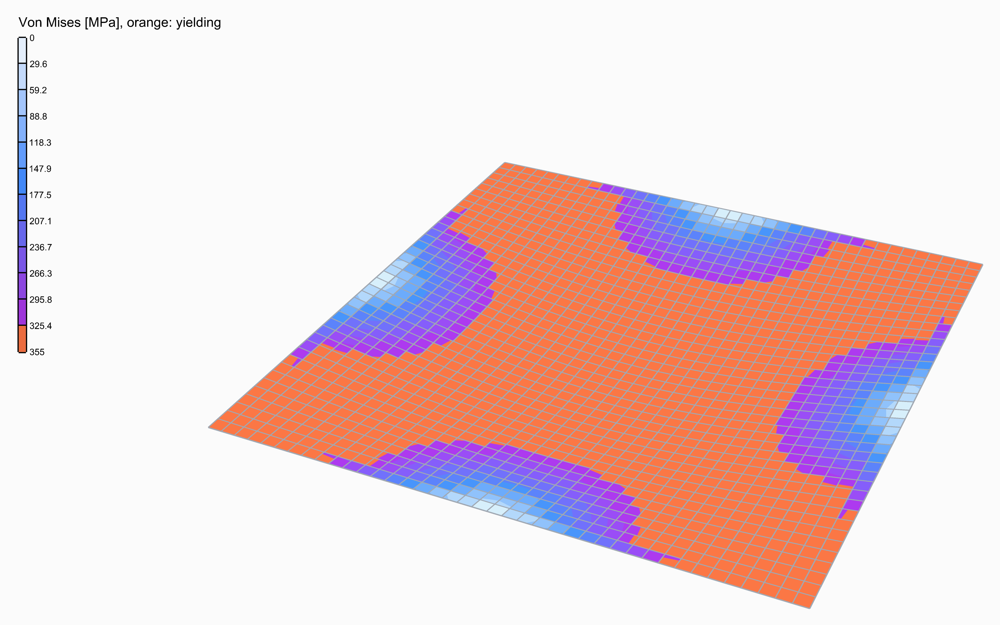
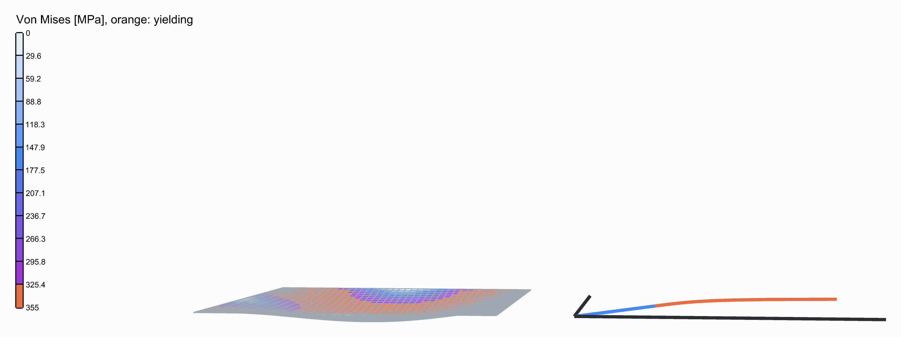
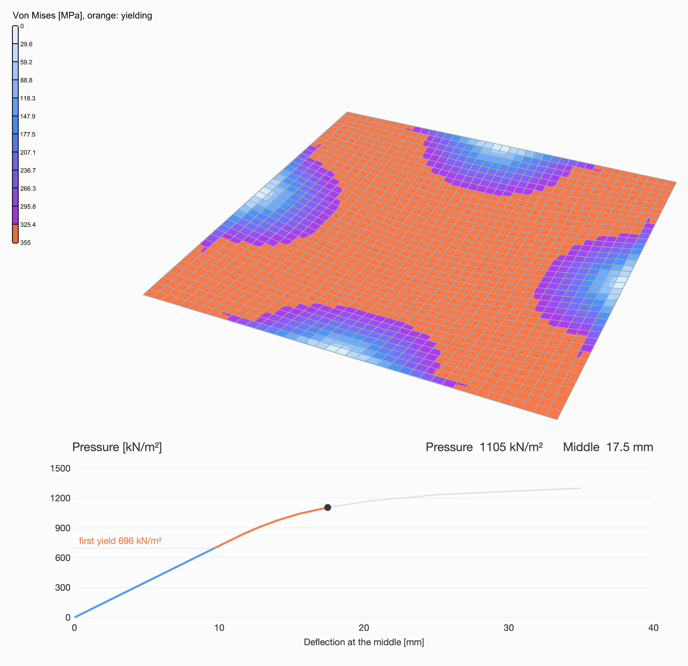

# ✖️ Steel Plate with Yield Lines

<figure><figcaption></figcaption></figure>

[yield-lines](yield-lines.gh)

A square S355 plate 1 x 1 m and 25 mm thick, simply supported on its four edges and its corners held
down, under a pressure, as 1 600 [ASD Shells](../../docs/basics/elements/shell.md). The steel is the
[nD](../../docs/basics/materials/ND.md) component's **J2Plasticity** unit. Twenty steps take the
pressure to 1 300 kN/m².

<figure><video src="yield-lines-pushing.mp4" autoplay loop muted playsinline></video><figcaption>
The push, a step a frame, drawn 4 times its deflection. Orange is steel at yield: first the corners, then the middle, then the diagonals between them. Under it, the deflection at the middle against the pressure.
</figcaption></figure>

## The model

| Group | What it does |
| --- | --- |
| 1 - The mesh | 40 x 40 squares. |
| 2 - Steel | J2Plasticity S355, perfectly plastic, in a Layered Shell of ten layers of 2.5 mm. |
| 3 - Supports | Its four edges held up and down, its corners too; one corner held along X and Y, the next along Y, so that the plate cannot slide or turn in its plane. |
| 4 - Load | 1 300 kN/m² down on every shell, with [Mesh Load](../../docs/basics/loads/shell-load.md), in a [Load Pattern](../../docs/basics/loads/load-pattern.md) on a [Linear Time Series](../../docs/basics/time-history/linear.md). |
| 5 - Assemble | [Assemble](../../docs/basics/assemble.md). |
| 6 - Pushed in steps | Newton and 20 steps of [Load Control](../../docs/basics/analysis/integrator.md) of 5%. |
| 7 - Von Mises | A [Model View](../../docs/basics/visualisation/model-view.md) of the Von Mises stress on the top face at the **Step** the slider picks, in Alpaca4d's colours, orange where the steel yields. |
| 8 - The curve | [Nodal Displacements](../../docs/basics/results/nodal-displacements.md) and Shell Stresses at every step, and a Python component that draws the deflection at the middle against the pressure: light blue while every point is elastic, orange after. |

<figure><figcaption>
As the example opens, at step 17: the plate, and the curve Grasshopper draws beside it.
</figcaption></figure>

## What it shows

The first steel to yield is not in the middle but at the corners, at about 700 kN/m². Held down, the
corners twist hard: the twisting moment there, in Von Mises terms, is larger than the bending at the
middle, where plate theory puts first yield at 772 kN/m². The middle follows, and then the yielding
joins them along the diagonals, until the plate has turned into four triangles hinging about the
lines between them - the pattern yield-line theory draws.

Yield-line theory gives that pattern a pressure of 24 mp / L² = 1 331 kN/m², with the plastic moment
mp = Fy t² / 4 = 55.5 kNm per metre. The model levels off at 1 347 kN/m², 1% over, as a model of the
whole plate, which lets the yielding spread over bands rather than lines, should.

The analysis is of small deflections. A plate that sags by more than its thickness also stretches, and
that membrane action carries more than bending alone; it is left out here, which is on the safe side.

<figure><figcaption>
The plate at 1 105 kN/m², its yield lines an X, and the whole curve.
</figcaption></figure>

## Try

- Move **Step** to watch the corners yield first, then the middle, then the diagonals.
- Free the corners to lift: support only the edges' middles, and the yield lines fork into corner fans.
- A rectangular plate: the diagonals meet along a ridge, as yield-line theory's envelope does.
- The plate has 1 600 elements, so it needs a license.
